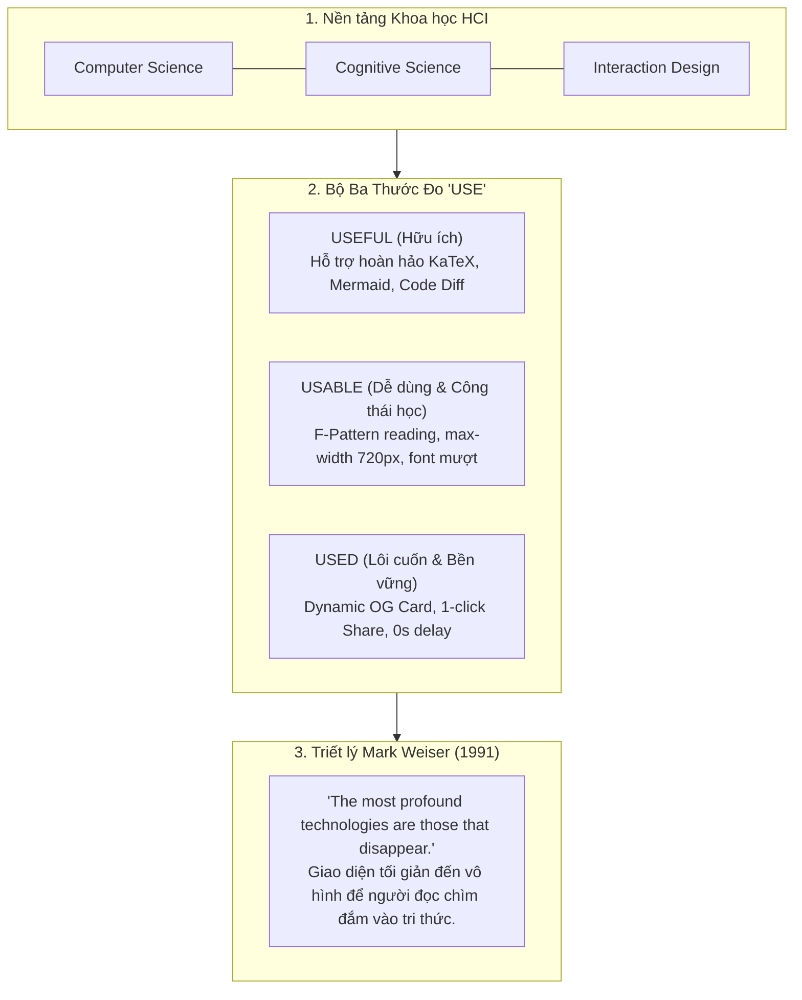

# TÀI LIỆU THIẾT KẾ HỆ THỐNG UI/UX & NAVIGATION MAP (DESIGN SYSTEM SPEC)

> **Dự án**: Multi-discipline Personal Blog (Tech, Engineering, Thoughts, Mathematics)  
> **Áp dụng nguyên lý**: Human-Computer Interaction (HCI), 3 "USE" Words, F-Pattern Eye-Tracking, và Triết lý Ubiquitous Computing.  
> **Thư mục lưu trữ**: `docs/DESIGN_SYSTEM.md`  
> **Ngày phê duyệt**: 2026-10-29

---

## 1. Nền tảng Lý thuyết HCI & Nguyên lý Trải nghiệm (HCI Principles)

Dựa trên tài liệu nghiên cứu HCI và tiến trình Design Thinking (Stanford d.school), hệ thống UI/UX của blog được xây dựng xoay quanh 4 trục nguyên lý:



### 1.1. Ứng dụng Nghiên cứu Eye-Tracking & F-Pattern (Mediatrive Heatmaps)
- **F-Pattern Scanning**: Người đọc trên màn hình kỹ thuật số luôn quét từ trái sang phải ở dòng đầu, sau đó quét dọc mép trái. Vì vậy:
  - Tất cả **Heading (H1, H2)**, **Icon chuyên mục**, **Metadata thời gian/tác giả** và **Mục lục TOC** luôn được thả neo ở mép trái thị giác.
- **Directional Cues (Chỉ báo hướng nhìn)**:
  - Tránh các yếu tố trang trí rườm rà làm phân tán tiêu điểm. Các nút hành động chính (Copy code, Share bài, Chuyển theme) được đặt đúng điểm rơi mắt cuối bài viết hoặc thanh nổi dính mép tiện dụng.
- **Cân bằng tương phản Dark UI vs Light UI**:
  - Ở Dark mode, ánh sáng trắng tinh `#ffffff` trên nền đen tuyền `#000000` gây hiện tượng quang sai (halation/chói mắt). Chúng tôi áp dụng thang xám kẽm (Zinc/Slate) dịu mắt: Nền `#090a0f`, Chữ `#e2e8f0`, tương phản chuẩn WCAG AAA.

---

## 2. Quy tắc Phối màu Chuẩn 60 - 30 - 10 (Color Strategy)

> [!IMPORTANT]
> **Đính chính & Làm rõ**: Quy tắc 60-30-10 là quy chuẩn phân bổ tỷ lệ diện tích cho **3 màu đơn sắc (Solid Colors)**. **Gradient không bao giờ được tính là một màu trong công thức 60-30-10**. Gradient (nếu có) chỉ được sử dụng như một lớp phủ ánh sáng vi mô trang trí (Decorative Wash/Aura) và tách bạch hoàn toàn khỏi tỷ lệ này.

Bảng màu được thiết lập theo phong cách **Academic Editorial / Scholarly Minimalism** (lấy cảm hứng từ chuẩn mực nghiên cứu khoa học và tài liệu HCI):

```
┌────────────────────────────────────────────────────────┐
│  60% - DOMINANT CANVAS (Nền chủ đạo)                  │
│  - Light Mode: #ffffff (Trang giấy trắng ngà sạch sẽ)  │
│  - Dark Mode:  #121316 (Nền than kẽm, không chói mắt)  │
│  Vai trò: Chiếm 60% diện tích, tạo khoảng thở đọc sách │
├────────────────────────────────────────────────────────┤
│  30% - SECONDARY SURFACE (Bề mặt & Cấu trúc phân tầng) │
│  - Light Mode: #f9fafb (Card), #e5e7eb (Viền tóc)      │
│  - Dark Mode:  #1a1b1f (Card), #27282d (Viền tóc)      │
│  Vai trò: Chiếm 30% diện tích đóng khung khối nội dung │
├────────────────────────────────────────────────────────┤
│  10% - ACCENT COLOR (Điểm nhấn tương tác duy nhất)    │
│  - Academic Crimson: #991b1b (Light) / #f87171 (Dark) │
│  - Hoặc Classic Deep Navy: #1e3a8a                     │
│  Vai trò: Chiếm 10% cho nút CTA, link active, badge   │
└────────────────────────────────────────────────────────┘
```

### Bảng Token Màu Sắc Đơn Sắc (Design Tokens)

| Token CSS | Light Mode | Dark Mode | Tỷ lệ & Vai trò kiến trúc |
| :--- | :--- | :--- | :--- |
| `--bg-canvas` | `#ffffff` | `#121316` | **60% Dominant**: Nền toàn bộ trang web |
| `--surface-card` | `#f9fafb` | `#1a1b1f` | **30% Secondary**: Khung card bài viết, bảng biểu |
| `--border-subtle` | `#e5e7eb` | `#27282d` | **30% Secondary**: Đường viền ngăn cách 1px mảnh mai |
| `--text-main` | `#111827` | `#f3f4f6` | Chữ chính (đen than / xám sáng tương phản cao) |
| `--text-muted` | `#4b5563` | `#9ca3af` | Chữ phụ, ngày tháng, thông tin meta |
| `--primary-accent`| `#991b1b` | `#f87171` | **10% Accent**: Màu nhấn duy nhất cho tương tác |

### 2.1. Về Kỹ thuật Chuyển sắc (Decorative Gradients - Tách rời)
Gradients không tham gia vào cấu trúc nhận diện chính của bài viết, chỉ xuất hiện vi mô ở:
- Lớp ánh sáng nền mờ cực nhạt ở Hero (`radial-gradient` độ mờ dưới 5%).
- Thanh phân cách trang trí mảnh `1px` giữa các phần lớn.
Tuyệt đối không lạm dụng các mảng màu neon/gradient chói lọi làm phân tán sự tập trung của độc giả.

---

## 3. Hệ thống Typography & Cơ chế Gợi ý Phông chữ Thông minh

Không áp đặt một font cứng nhắc cho mọi thể loại. Hệ thống hỗ trợ đa dạng phông chữ có chân (Serif) và không chân (Sans-serif) cùng **cơ chế tự động gợi ý (Recommendation Heuristics)**:

## 3. Hệ thống Typography & Quy Chuẩn Chống Vỡ Dấu Tiếng Việt

> [!CAUTION]
> **Đặc thù tiếng Việt**: Tiếng Việt có hệ thống dấu thanh và dấu mũ xếp tầng (như `ễ`, `ệ`, `ở`, `ỡ`, `ử`, `ự`, `ắ`, `ặ`). Nếu kích thước chữ quá to, line-height quá thấp hoặc co khoảng cách ký tự (negative tracking), dấu sẽ bị **cắt ngọn (clipping)**, **đè chữ dòng trên** hoặc **dính bệt vào ký tự kế tiếp**, làm vỡ hoàn toàn typography.

### 3.1. Bảng Giới Hạn Kích Thước Cứng (Strict Size & Line-Height Budgets)

| Cấp bậc | Giới hạn Kích thước (Clamp) | Line-Height Bắt buộc | Letter-Spacing | Mục đích & Ngăn chặn lỗi |
| :--- | :--- | :--- | :--- | :--- |
| **H1 (Tiêu đề bài)** | `clamp(1.75rem, 3.5vw, 2.25rem)` (28px &rarr; tối đa 36px) | `1.4` &rarr; `1.45` (39px &rarr; 52px) | `normal` (0) | **Trần tối đa 36px**. Cấm dùng 48px/64px vì dấu mũ sẽ bị phóng đại thô kệch |
| **H2 (Tiêu đề mục)** | `1.375rem &rarr; 1.5rem` (22px &rarr; 24px) | `1.4` (31px &rarr; 34px) | `normal` (0) | Giữ dấu không chạm vào chữ hoa hoặc ký tự hàng trên |
| **H3 (Tiểu mục)** | `1.125rem &rarr; 1.25rem` (18px &rarr; 20px) | `1.45` (26px &rarr; 29px) | `normal` (0) | Cân đối với body text, phân cấp rõ ràng |
| **Body (Nội dung đọc)** | **Khóa cứng 16px &rarr; 17px** (`1rem &rarr; 1.0625rem`) | `1.75 &rarr; 1.8` (28px &rarr; 30px) | `normal` (0) | Khoảng thở 8-10px phía trên chữ cái để dấu thanh thở tự nhiên |
| **Meta / Caption** | **Sàn tối thiểu 13px** (`0.8125rem`) | `1.5` (20px) | `normal` (0) | **Cấm dưới 12px**: Chữ < 12px làm dấu hỏi/ngã bị biến thành đốm mờ |

---

### 3.2. Ba Điều Cấm Tuyệt Đối Trong Typography Tiếng Việt
1. 🚫 **CẤM DÙNG NEGATIVE TRACKING (`tracking-tight`, `tracking-tighter`)**:
   - Ở tiếng Anh, designer hay khép chữ lại (`-0.025em`) cho "hiện đại". Nhưng trong tiếng Việt, khi khép chữ, các dấu thanh sẽ va quẹt và dính bệt vào chữ bên cạnh (ví dụ chữ *"Xác thực email"* khép chữ sẽ biến thành *"thựcemail"*). **Bắt buộc dùng `tracking-normal`**.
2. 🚫 **CẤM DÙNG LINE-HEIGHT QUÁ THẤP (`leading-none`, `leading-tight`)**:
   - Không bao giờ để `line-height < 1.35` ở tiêu đề và `< 1.7` ở body. Line-height thấp khiến các ký tự có đuôi dòng trên (`g`, `y`, `p`) đâm thủng dấu mũ của dòng dưới (`Ấ`, `Ế`, `Ỗ`).
3. 🚫 **CẤM KHỐI CHỮ QUÁ RỘNG (`max-width > 55ch`)**:
   - Ký tự tiếng Việt hẹp hơn tiếng Anh (~6.8px so với 9.5px). Khung đọc bài dài được khóa cứng ở `max-w-[55ch]` (~680px - 720px) để vừa vặn 65-75 ký tự/dòng, mắt chuyển dòng không bị mỏi.

---

### 3.3. Ma trận Phông chữ Tuyển chọn (Typography Matrix)

| Chế độ Đọc | Họ Font tuyển chọn | Lý do không bị vỡ tiếng Việt | Thể loại phù hợp |
| :--- | :--- | :--- | :--- |
| **Modern Technical Sans** | **Be Vietnam Pro** / **Inter** | Thiết kế chuyên biệt cho tiếng Việt; dấu mũ và thanh được cân chỉnh tỷ lệ vi mô | **Tech & Engineering** |
| **Academic Paper** | **Times New Roman** / **STIX Two Text** | Chuẩn mực hàn lâm arXiv/Nature; subset tiếng Việt đầy đủ, thanh lịch | **Paper Review, Khoa học & Toán** |
| **Literary Serif** | **Literata** / **Newsreader** | Font văn học cao cấp, dấu thanh uốn lượn tự nhiên, không bị đè nét | **Thoughts & Chiêm nghiệm** |
| **Code Monospace** | **JetBrains Mono** | Ký tự cố định, phân biệt rõ từng ký tự lập trình | **Khung Code & Ký hiệu** |
| **Math KaTeX** | **Latin Modern Math** | Chuẩn công thức toán học viện Hàn lâm quốc tế | **Phương trình & Công thức** |

---

## 4. Quy chuẩn Icon Framework (Iconography Rules)

- 🚫 **ĐIỀU CẤM TUYỆT ĐỐI**: **Không bao giờ sử dụng icon laptop generic** (hình chiếc laptop mở màn hình rẻ tiền thường thấy trên các web mẫu AI).
- ✅ **ĐỒNG NHẤT 1 FRAMEWORK**: Toàn bộ icon sử dụng **Lucide Icons** với quy chuẩn:
  - Stroke-width: Cố định `1.75px` (tinh tế, hiện đại).
  - Bounding box: `20x20px` hoặc `16x16px`.
  - Icon thay thế cho chuyên mục Tech: Dùng icon `Terminal`, `Binary`, `Cpu`, hoặc `Code2`.
  - Icon cho Engineering: Dùng `Network`, `Workflow`, `Boxes`, `Layers`.
  - Icon cho Mathematics: Dùng `Sigma`, `Variable`, `Pi`, `Activity`.
  - Icon cho Thoughts: Dùng `Feather`, `BookOpen`, `Compass`, `Sparkles`.

---

## 5. Quy chuẩn Trình diễn Sơ đồ Kỹ thuật (Mermaid Representation Standard)

Mọi sơ đồ Mermaid đều được hiển thị trong một **Technical Canvas Card**:
1. **Thanh Header của Card**:
   - Icon `Workflow` + Tên sơ đồ (ví dụ: *System Architecture Flow*).
   - Tag loại sơ đồ: `sequenceDiagram` / `flowchart TD` / `stateDiagram`.
   - Nút hành động: **Copy Mermaid Code** và **Phóng to (Fullscreen View)**.
2. **Khung vẽ SVG**:
   - Nền canvas xám nhạt (`--surface-card`) có lưới chấm chấm chấm (dot-grid pattern) công nghệ.
   - Bo góc card chuẩn `12px` (`rounded-xl`), viền 1px tinh xảo.
   - Các node và cạnh nối tự động thích ứng với Dark/Light mode (chữ luôn tương phản cao, nét vẽ vector sắc mịn).

---

## 6. Sơ đồ Điều hướng Toàn diện (Navigation Map & Information Architecture)

```
[Trang Chủ (/)]
   │
   ├── Hero Section: Lời giới thiệu, Tôn chỉ chia sẻ
   ├── Chuyên mục Lọc nhanh (Tabs Pill)
   │     ├── [Tech] (/category/tech) ──────────┐
   │     ├── [Engineering] (/category/eng) ────┤
   │     ├── [Mathematics] (/category/math) ───┼──> [Trang Bài Viết Chi Tiết]
   │     └── [Thoughts] (/category/thoughts) ──┘        │
   ├── Search Modal (Cmd+K / Ctrl+K)                    ├── Breadcrumbs Nav Map (Home > Category > Title)
   ├── Design System Showcase (/ui)                     ├── Metadata (Tác giả, Ngày, Thời gian đọc, Badge)
   └── Về Tác Giả (/about)                              ├── Sticky Table of Contents (TOC)
                                                        ├── Vùng Nội dung (Code / Math / Mermaid / Callout)
                                                        ├── Thanh Chia sẻ 1-Click (FB, X, LinkedIn, Copy)
                                                        └── Bài viết Liên quan & Điều hướng Trước/Sau
```


---

## 7. Hệ Thống Lưới 12 Cột & Không Gian Chuẩn 4*x px (Mathematical Spatial Grid)

> [!IMPORTANT]
> **Quy chuẩn Không gian Toán học (4*x px System)**: Mọi khoảng cách (padding, margin, gap), kích thước phần tử (chiều cao nút, khung nhập liệu), bán kính bo góc và chiều rộng lưới đều bắt buộc là **bội số của 4px (`4 * x` px)**. Không sử dụng các con số lẻ (11px, 13px, 17px, 23px) để đảm bảo nhịp điệu thị giác (Vertical & Horizontal Rhythm) hài hòa tuyệt đối.

### 7.1. Bảng Thang Đo Không Gian 4*x px

| Bội số (`x`) | Kích thước (px) | Token Tailwind tương ứng | Vị trí áp dụng chuẩn |
| :--- | :--- | :--- | :--- |
| **1 * 4** | **4px** | `p-1`, `gap-1`, `rounded-sm` | Khoảng cách vi mô giữa icon và nhãn, bo góc nhỏ |
| **2 * 4** | **8px** | `p-2`, `gap-2`, `rounded-lg` | Padding dọc của button, khoảng cách giữa các tags |
| **3 * 4** | **12px** | `p-3`, `gap-3`, `rounded-xl` | Bo góc tiêu chuẩn của Card, padding trong ô input |
| **4 * 4** | **16px** | `p-4`, `gap-4`, `rounded-2xl` | Padding tiêu chuẩn của card, khoảng cách giữa các khối |
| **5 * 4** | **20px** | `p-5`, `gap-5` | Khoảng cách trung bình, cỡ chữ H3 (20px) |
| **6 * 4** | **24px** | `p-6`, `gap-6` | **Khoảng hở rãnh lưới (Grid Gutter)**, padding card lớn |
| **8 * 4** | **32px** | `p-8`, `gap-8` | Khoảng cách giữa các section lớn, trần font H1 (32px) |
| **10 * 4** | **40px** | `h-10`, `gap-10` | Chiều cao tiêu chuẩn của Button và Input |
| **12 * 4** | **48px** | `p-12`, `gap-12` | Khoảng đệm đầu/cuối của các khối nội dung |
| **16 * 4** | **64px** | `h-16`, `gap-16` | **Chiều cao cố định của Thanh điều hướng (Navbar)** |
| **180 * 4**| **720px** | `max-w-[720px]` | **Độ rộng tối ưu của cột đọc bài viết (Reading Column)** |

---

### 7.2. Cấu Trúc Lưới 12 Cột (12-Column Responsive Grid)
- **Tổng chiều rộng container**: `1280px` (Desktop max-width: `max-w-7xl`).
- **Khoảng cách rãnh (Gutter)**: Cố định `24px` (`gap-6 = 4 * 6px`).
- **Phân bổ tỷ lệ cột**:
  - **Trang chủ & Danh sách**:
    - **8 cột (66.6%)**: Dòng bài viết (Feed & Featured Post).
    - **4 cột (33.3%)**: Sidebar tác giả, Chủ đề & Nhóm tag.
  - **Trang đọc bài viết (Article Layout)**:
    - **8 cột (66.6%)**: Cột đọc bài chính (khóa cứng tối đa `720px` căn giữa).
    - **4 cột (33.3%)**: Cột mục lục (Sticky Table of Contents) và thanh công cụ tiện ích.
- **Tính năng Grid Overlay trong Prototype**: Bản mẫu có nút bật/tắt lưới hồng 12 cột minh chứng trực quan việc khớp 100% từng pixel vào rãnh lưới.
