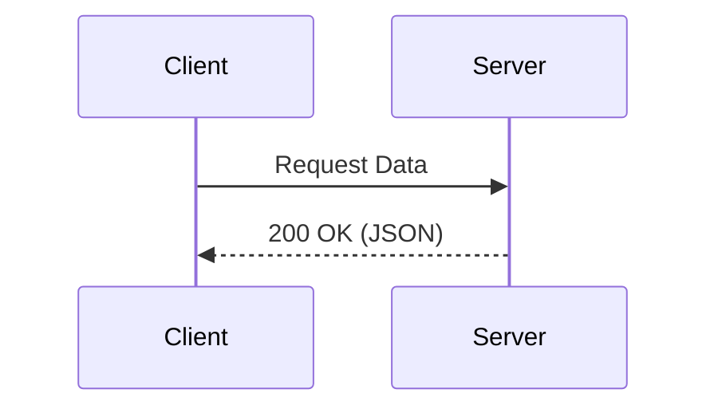

# TÀI LIỆU YÊU CẦU DỰ ÁN BLOG (PROJECT SPECIFICATIONS)

> **Trạng thái**: Bản thảo v1.0 (Draft)  
> **Thư mục lưu trữ**: `docs/REQUIREMENTS.md`  
> **Ngày cập nhật**: 2026-10-29

---

## 1. Mục tiêu & Định vị Dự án

1. **Mục đích**: Xây dựng một không gian cá nhân độc lập để chia sẻ tự do những nội dung tác giả muốn truyền tải: từ kỹ thuật, kiến trúc hệ thống, toán học đến tản văn, chiêm nghiệm cá nhân.
2. **Khả năng lan tỏa (Shareability)**: Tối ưu khả năng chia sẻ ra mạng xã hội (Facebook, X/Twitter, LinkedIn, Telegram) với 1-click share và Dynamic OpenGraph (tự động render card preview đẹp mắt khi gửi link).
3. **Quyền sở hữu dữ liệu**: Không phụ thuộc vào các nền tảng đóng (Medium, Substack); toàn bộ bài viết được lưu trữ dưới dạng text/Markdown trong Git.

---

## 2. Các Chuyên mục Cốt lõi & Yêu cầu Hiển thị Đặc thù

Blog phục vụ 4 trụ cột nội dung chính:

| Chuyên mục | Định hướng nội dung | Yêu cầu kỹ thuật hiển thị đặc thù |
| :--- | :--- | :--- |
| **Tech** | Lập trình, công nghệ, công cụ, hướng dẫn kỹ thuật | Code block có syntax highlighting, copy 1-click, line numbers, diff code |
| **Engineering** | Kiến trúc hệ thống, phần mềm, thiết kế phân tán | **Hỗ trợ sơ đồ Mermaid** (Flowcharts, Sequence Diagrams, State, Mindmaps) render trực tiếp trên web |
| **Mathematics** | Lý thuyết toán học, giải thuật, chứng minh | **Hỗ trợ KaTeX / LaTeX** (inline `$...$` và block `$$...$$`), render chuẩn xác, sắc nét, không giật layout |
| **Thoughts** | Tản văn, góc nhìn cá nhân, chiêm nghiệm | Typography bài đọc dài (long-form reading) thoáng đãng, lùi dòng, nhịp điệu đọc thư giãn |

---

## 3. Đặc tả Typography cho Tiếng Anh & Tiếng Việt / "Vietlish"

Do bài viết thường pha trộn thuật ngữ kỹ thuật tiếng Anh với tiếng Việt ("Vietlish"), font chữ bắt buộc phải giải quyết triệt để vấn đề: **không lỗi dấu tiếng Việt (bị lệch glyph, dấu bị co cụm hoặc rơi về font fallback hệ thống)**.

### Bộ Font Đề xuất (Font Pairing)

```
┌────────────────────────────────────────────────────────┐
│  HEADING: Plus Jakarta Sans / Inter Display            │
│  - Hỗ trợ full UTF-8 tiếng Việt                        │
│  - Nét hiện đại, hình học (geometric), dứt khoát       │
├────────────────────────────────────────────────────────┤
│  ACADEMIC / PAPER: Times New Roman / STIX Two Text     │
│  - Chuẩn mực các bài báo nghiên cứu khoa học (arXiv,   │
│    IEEE, ACM, Nature)                                  │
│  - Phục vụ phân tích chuyên sâu các paper khoa học     │
├────────────────────────────────────────────────────────┤
│  BODY TEXT (VĂN PHONG): Be Vietnam Pro                 │
│  - Được thiết kế đặc biệt tối ưu cho dấu tiếng Việt    │
│  - Khoảng cách dấu thanh tự nhiên, đọc bài dài êm mắt  │
│  - Khi chèn từ tiếng Anh kỹ thuật không bị lệch nét    │
├────────────────────────────────────────────────────────┤
│  CODE: JetBrains Mono / Fira Code                      │
│  - Hỗ trợ programming ligatures (->, !=, ===)          │
│  - Rõ ràng từng ký tự, phân biệt l, 1, I, O, 0        │
├────────────────────────────────────────────────────────┤
│  MATH FORMULAS: KaTeX Fonts (Computer Modern)          │
│  - Chuẩn mực hiển thị công thức toán học viện Hàn lâm  │
└────────────────────────────────────────────────────────┘
```

### Quy chuẩn kích thước & Nhịp chữ (Type Scale)
- **Cỡ chữ Body**: `16px - 17px`, line-height `1.75` (28px - 30px).
- **Độ rộng khối đọc**: Khóa cứng ở `680px - 740px` (khoảng 65 - 75 ký tự/dòng).
- **Heading scale**:
  - H1: `2.25rem` (36px), font-weight 700.
  - H2: `1.75rem` (28px), font-weight 600, margin-top thoáng (`2.5rem`).
  - H3: `1.35rem` (22px), font-weight 600.

---

## 4. Đặc tả Sơ đồ Kỹ thuật (Mermaid Diagram Spec)

Hệ thống cho phép viết trực tiếp block mermaid trong bài viết:
````markdown

````
- **Client-side & Server-rendered**: Tự động nhận diện block `mermaid`, vẽ SVG vector sắc nét, hỗ trợ zoom/pan nếu sơ đồ lớn.
- **Dark/Light Theme**: Tự động chuyển màu sơ đồ theo chế độ sáng/tối của blog.

---

## 5. Đặc tả Chia sẻ & Tương tác (Social & OpenGraph)

1. **Share Bar (Thanh chia sẻ)**:
   - Nút Copy Link (kèm thông báo toast "Đã sao chép liên kết!").
   - Nút Share Facebook, X (Twitter), LinkedIn, Telegram.
2. **Dynamic OpenGraph Image**:
   - Khi chia sẻ đường dẫn lên mạng xã hội, máy chủ tự động sinh ảnh card 1200x630px chứa:
     - Tên bài viết (H1)
     - Tag chuyên mục (Tech / Math / Thoughts...)
     - Ngày tháng & Tác giả
     - Vibe màu sắc chủ đạo của bài viết.

---

## 6. Quy trình Đăng bài & Quản lý Nội dung (CMS)

- **Trực tiếp trên Web (Admin UI)**: Tích hợp Keystatic/Decap CMS tại `/keystatic` hoặc `/admin`.
  - Có form nhập tiêu đề, slug, ngày, tóm tắt, chuyên mục.
  - Trình soạn thảo trực quan hỗ trợ Markdown, KaTeX, Mermaid, upload ảnh.
  - Bấm **Publish**: Hệ thống tự động commit file `.md`/`.mdx` vào kho lưu trữ Git và trigger Edge build.
- **Viết Local**: Có thể mở thư mục bằng VS Code/Obsidian, tạo file `.md` trong thư mục `src/content/posts/` và push Git như bình thường.

---

## 7. Hạ tầng Triển khai & CDN (Hosting Architecture)

- **Nhà cung cấp**: **Cloudflare Pages** (hoặc Vercel Edge).
- **Mạng lưới phân phối (Edge CDN)**:
  - Phân phối qua 300+ PoPs toàn cầu (có trạm trực tiếp tại Hà Nội và TP.HCM).
  - Tốc độ phản hồi (TTFB): 5ms - 20ms tại Việt Nam.
  - Băng thông: Không giới hạn (Unlimited).
  - Bảo mật: Tự động cấp chứng chỉ SSL/TLS, chống DDoS cấp độ mạng (L3/L4/L7).
