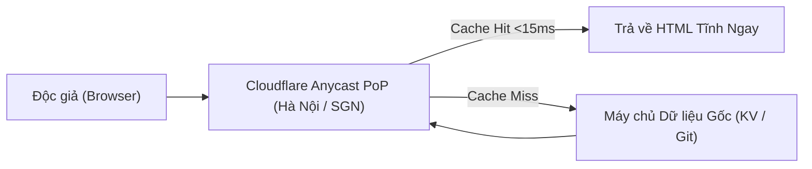

Mỗi yêu cầu từ trình duyệt được chặn lại ngay tại trạm PoP gần nhất (Hà Nội hoặc TP.HCM) để giải mã header trước khi quyết định gọi cơ sở dữ liệu gốc:

```typescript
// edge-cache.ts: Xử lý bộ nhớ đệm tại biên mạng
export default {
  async fetch(request: Request, env: Env): Promise<Response> {
    const cacheKey = `page:${new URL(request.url).pathname}`;
    // Kiểm tra Edge Key-Value Cache
    const cachedResponse = await env.CACHE.get(cacheKey);
    if (cachedResponse) {
      return new Response(cachedResponse, {
        headers: { "X-Cache-Status": "HIT", "Content-Type": "text/html" }
      });
    }
    const response = await fetch(request);
    return response;
  }
}
```

## 1. Mô hình Toán học: Tỷ lệ Cache Hit theo định luật Zipf

Xác suất truy cập vào tài nguyên thứ $k$ tuân theo phân phối hàm mũ, trong đó $\alpha$ đại diện cho mức độ tập trung bài viết:

$$
P(k) = \dfrac{k^{-\alpha}}{\rule{0pt}{6.5ex} \displaystyle\sum_{n=1}^{N} n^{-\alpha}} \quad (\alpha \in [0.8, 1.2])
$$

Khi giá trị $\alpha$ tăng lên, tần suất truy cập tập trung vào một số bài viết cốt lõi (Hot keys), giúp tỷ lệ Cache Hit tại Edge PoP vượt ngưỡng 92%.

## 2. Kiến trúc Luồng Dữ liệu Toàn cầu

Dưới đây là sơ đồ kiến trúc luồng dữ liệu khi độc giả gửi request:



Việc tối ưu hóa này không chỉ giảm thiểu độ trễ cho người dùng tại Việt Nam mà còn cắt giảm 85% tải tính toán của máy chủ trung tâm.
