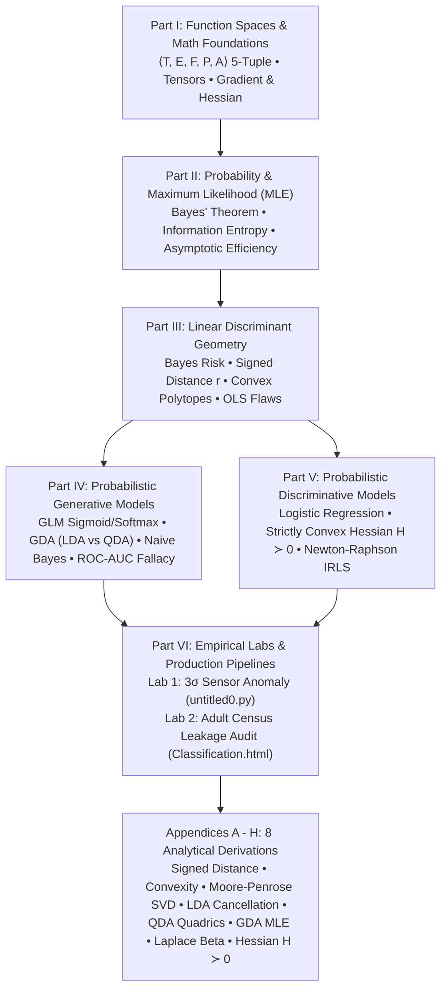
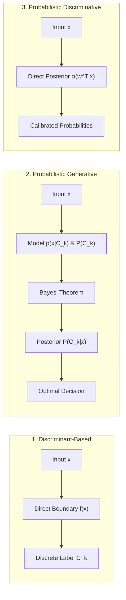
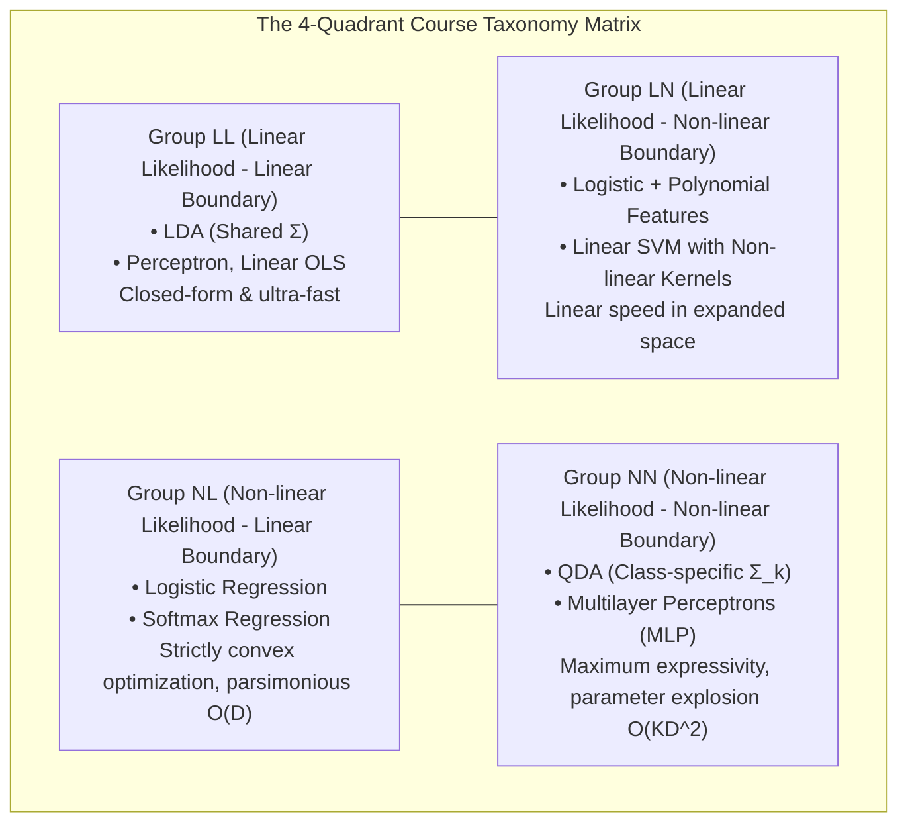
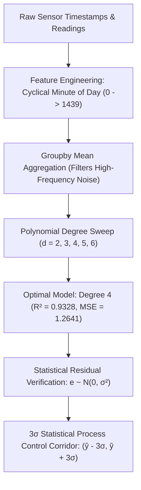

> **BILINGUAL ACADEMIC RESOURCE PACK (VNUK MIDTERM 2026)**
> This comprehensive guide is synchronized directly with the standardized Machine Learning curriculum at **VNUK Institute for Research and Executive Education, The University of Danang** (Instructors: Chi Thien NGUYEN, MSc & Thanh Hoa TRAN, PhD). Readers can access all official publication monographs below:
> 
> * **English Midterm Monograph (Pure Academic English, 101 Pages A4, 458 KB):**  
>   [Download ML_midterm_en.pdf (PDF 101 Pages A4)](/downloads/ML_midterm_en.pdf)
> * **Vietnamese Midterm Compendium (Bản chuẩn Midterm 101 Trang A4, 484 KB):**  
>   [Tải xuống ML_midterm_vi.pdf (PDF 101 Trang A4)](/downloads/ML_midterm_vi.pdf)
> * **Foundations & Deep Architectures Monograph (93 Pages A4, 457 KB):**  
>   [Download Giao_Trinh_Machine_Learning_Toan_Dien.pdf (PDF 93 Pages A4)](/downloads/Giao_Trinh_Machine_Learning_Toan_Dien.pdf)
> * **Vietnamese Online Edition:**  
>   [Đọc bản Cẩm Nang Ôn Tập Midterm Tiếng Việt →](/posts/on-tap-hoc-may-midterm-toan-dien/)

---

## Preface & Pedagogical Architecture

<span class="focus-key-pill">FOCUS KEY 00: PEDAGOGICAL ARCHITECTURE & ROADMAP</span>

In modern computer science, treating Machine Learning merely as an empirical black-box routine — loading tabular arrays into `scikit-learn`, executing `fit()`, and reporting a baseline `score()` — creates a perilous vulnerability. When deployed into industrial production pipelines, ungrounded models quickly suffer from catastrophic failures: <mark class="hl-warn">Data Leakage</mark>, covariate shift, numerical divergence, or high sensitivity to outliers.

This **101-page Midterm Monograph** establishes a mathematically rigorous foundation across four pillars:
1. **Coordinate-Free Function Spaces**: Viewing learning as an automated optimization search across candidate function spaces $\mathcal{F}$.
2. **Decision Boundary Geometry**: Visualizing linear hyperplanes, orthogonal normal weight vectors, signed distance formulas, and the intrinsic convexity of multi-class decision polytopes.
3. **Rigorous Optimization Dynamics**: Contrasting closed-form Normal Equations and Moore-Penrose pseudoinverses against second-order Newton-Raphson and <mark class="hl-key"><mark class="hl-key">Iteratively Reweighted Least Squares (IRLS)</mark></mark>.
4. **Data Engineering Hygiene**: Auditing insidious data leakage vectors within preprocessing pipelines and engineering robust $3\sigma$ statistical process control bands for streaming IoT sensor telemetry.

Below is the interactive architectural roadmap tracing the core conceptual flow across all 6 Parts and 17 Chapters:



---

## PART I: MATHEMATICAL FOUNDATIONS & FUNCTION SPACES

### 1. The Machine Learning Paradigm & The 5-Tuple Formulation

<span class="focus-key-pill">FOCUS KEY 01: CANONICAL 5-TUPLE DEFINITION</span>

Machine learning is not rote data memorization; it is the mathematical process of <mark class="hl-focus">inductive generalization</mark>. Following the unified framework of Tom Mitchell and Michael I. Jordan, any rigorous machine learning task is formalized as a <mark class="hl-zoom">canonical 5-tuple</mark>:

$$
\mathcal{M} = \langle T, E, \mathcal{F}, P, A \rangle
$$

* **$T$ (Task)**: The operational objective to be solved, e.g., continuous regression ($f: \mathbb{R}^d \to \mathbb{R}$), binary classification ($f: \mathbb{R}^d \to \{0, 1\}$), multi-class discrimination ($f: \mathbb{R}^d \to \{1, \dots, K\}$), or latent structure representation.
* **$E$ (Experience)**: The empirical observation corpus $\mathcal{D} = \{(x_i, y_i)\}_{i=1}^N$ (supervised) or $\mathcal{D} = \{x_i\}_{i=1}^N$ (unsupervised).
* **$\mathcal{F}$ (Function Space)**: The candidate hypothesis space accessible to the learner, parameterized by parameter vector $\theta \in \Theta$: $\mathcal{F}_\Theta = \{f(x; \theta) : \theta \in \Theta\}$.
* **$P$ (Performance Measure)**: The quantitative evaluation metric, e.g., empirical risk $\hat{R}_N(f)$, $R^2$, Mean Squared Error (MSE), Cross-Entropy loss, Accuracy, or Macro-$F_1$.
* **$A$ (Algorithm)**: The mathematical optimization engine navigating parameter space $\Theta$, such as closed-form Normal Equations, Stochastic Gradient Descent (SGD), or second-order Newton-Raphson.

<div class="callout-trap">
<strong>EXAM TRAP — <mark class="hl-warn">THE TARGET PRESENCE FALLACY</mark>:</strong><br>
The mere existence of a column labeled <code>target</code> or <code>label</code> in a dataset does not automatically restrict the research question to Supervised Learning. Conversely, artificially assigning integer cluster IDs via k-Means does <em>not</em> manufacture scientific ground-truth labels. Ground-truth requires independent external validation.
</div>

### 2. Abstract Vector Spaces, Basis Expansions & Tensor Calculus

<span class="focus-key-pill">FOCUS KEY 02: BASIS FUNCTION EXPANSION & TENSORS</span>

Digital processors cannot compute continuous, coordinate-free functions directly. To render function search computationally tractable, we project functions onto an abstract **Vector Space** $\langle V, \mathbb{R}, +, \cdot \rangle$.

Every hypothesis function $f(x) \in \mathcal{F}$ is expressed as a <mark class="hl-focus">linear combination of $M$ pre-determined basis functions</mark> $\{\phi_j(x)\}_{j=1}^M$:

$$
f(x) = \sum_{j=1}^M w_j \phi_j(x) = \mathbf{w}^T \boldsymbol{\phi}(x)
$$

This reduces an infinite-dimensional search over functional curves to finding coordinate vector $\mathbf{w} \in \mathbb{R}^M$ in finite Euclidean space $\mathbb{R}^M$.

Data structures are hierarchically organized into multi-dimensional tensors:
* **Rank-0 Tensor (Scalar)**: Scalar value ($y \in \mathbb{R}$).
* **Rank-1 Tensor (Vector)**: An individual feature vector ($x \in \mathbb{R}^D$).
* **Rank-2 Tensor (Matrix)**: Design matrix $X \in \mathbb{R}^{N \times D}$ aggregating $N$ observations across $D$ features.
* **Rank-3 Tensor**: A color image $[C, H, W]$ across 3 RGB channels, or multivariate sensor streams $[N, T, D]$.
* **Rank-4 Tensor**: Mini-batches of image inputs $[B, C, H, W]$ in deep convolutional networks.

### 3. Loss Surfaces, Gradient Fields, Jacobians & Hessians

<span class="focus-key-pill">FOCUS KEY 03: EXTREMUM CONDITIONS & CURVATURE</span>

Optimization algorithms traverse the high-dimensional geometry of loss surface $\mathcal{L}(\mathbf{w})$:
* **Gradient Vector $\nabla \mathcal{L}(\mathbf{w}) \in \mathbb{R}^D$**: Direction of steepest rate of increase; moving along $-\nabla \mathcal{L}(\mathbf{w})$ guarantees steepest descent.
* **Jacobian Matrix $J \in \mathbb{R}^{m \times n}$**: First-order partial derivatives of vector-valued mapping $\mathbf{f}: \mathbb{R}^n \to \mathbb{R}^m$.
* **Hessian Matrix $H = \nabla^2 \mathcal{L}(\mathbf{w}) \in \mathbb{R}^{D \times D}$**: Second-order partial derivatives $H_{ij} = \frac{\partial^2 \mathcal{L}}{\partial w_i \partial w_j}$, capturing the multi-dimensional local curvature.

<div class="callout-anchor">
<strong>CORE ANCHOR — EXTREMUM CRITERIA:</strong><br>
1. <strong>First-Order Necessary Condition</strong>: <mark class="hl-key">$\nabla \mathcal{L}(\mathbf{w}^*) = \mathbf{0}$</mark> (stationary point).<br>
2. <strong>Second-Order Sufficient Condition</strong>: If <mark class="hl-zoom">$H(\mathbf{w}^*) \succ 0$</mark> (Hessian is strictly positive definite everywhere), the loss surface is <mark class="hl-zoom">strictly convex</mark>, and stationary point $\mathbf{w}^*$ is the <mark class="hl-focus">unique global minimum</mark>.
</div>

---

## PART II: PROBABILITY FOUNDATIONS & MAXIMUM LIKELIHOOD ESTIMATION (MLE)

### 4. Probability Axioms, Bayes' Theorem & Shannon Entropy

<span class="focus-key-pill">FOCUS KEY 04: BAYESIAN INFERENCE & SHANNON ENTROPY</span>

Probability provides the calculus for quantifying epistemic uncertainty. Bayes' theorem governs how prior beliefs are rationally transformed into posterior confidences upon observing empirical feature vector $x$:

$$
P(C_k | x) = \frac{p(x | C_k) P(C_k)}{p(x)} = \frac{p(x | C_k) P(C_k)}{\sum_{j=1}^K p(x | C_j) P(C_j)}
$$

* $P(C_k)$: Prior probability — the natural prevalence of class $C_k$ before observing $x$.
* $p(x | C_k)$: Class-conditional likelihood — the probability density of generating feature $x$ given class $C_k$.
* $p(x) = \sum_j p(x | C_j)P(C_j)$: Evidence marginal factor ensuring $\sum_k P(C_k | x) = 1$.
* $P(C_k | x)$: Posterior probability — the calibrated belief that observation $x$ belongs to $C_k$.

**<mark class="hl-key">Shannon Information Entropy</mark>:**
Quantifies the intrinsic uncertainty of discrete random variable $X$:

$$
H(X) = -\sum_{i=1}^n P(x_i) \log_2 P(x_i)
$$

Entropy is maximized when all outcomes are equi-probable (uniform distribution — maximum uncertainty) and vanishes to 0 when the outcome is completely deterministic.

### 5. Maximum Likelihood Estimation & Asymptotic Properties

<span class="focus-key-pill">FOCUS KEY 05: MLE ASYMPTOTIC EFFICIENCY</span>

Given $N$ independent and identically distributed (i.i.d.) observations $\mathcal{D} = \{x_1, \dots, x_N\}$ drawn from parameterized density $p(x; \theta)$, the log-likelihood function is:

$$
\ell(\theta) = \ln \prod_{n=1}^N p(x_n; \theta) = \sum_{n=1}^N \ln p(x_n; \theta) \implies \hat{\theta}_{\text{MLE}} = \arg\max_\theta \ell(\theta)
$$

#### Multivariate Gaussian Closed-Form Estimators $\mathcal{N}(\mu, \Sigma)$
Setting $\nabla_\mu \ell = 0$ and $\nabla_\Sigma \ell = 0$ yields:

$$
\hat{\mu}_{\text{MLE}} = \frac{1}{N} \sum_{n=1}^N x_n, \qquad \hat{\Sigma}_{\text{MLE}} = \frac{1}{N} \sum_{n=1}^N (x_n - \hat{\mu})(x_n - \hat{\mu})^T
$$

<div class="callout-intuition">
<strong>MATHEMATICAL INTUITION — BESSEL'S CORRECTION:</strong><br>
The covariance estimator $\hat{\Sigma}_{\text{MLE}}$ is slightly <mark class="hl-warn">biased</mark> because it divides by $N$ rather than $(N - 1)$. However, as $N \to \infty$, the bias converges to 0. MLE guarantees three golden asymptotic properties:<br>
1. <mark class="hl-focus">Consistency</mark>: $\hat{\theta}_N \xrightarrow{P} \theta^*$ (converges in probability to the ground-truth parameter).<br>
2. <mark class="hl-focus">Asymptotic Normality</mark>: $\sqrt{N}(\hat{\theta}_N - \theta^*) \xrightarrow{d} \mathcal{N}(0, \mathcal{I}(\theta^*)^{-1})$, where $\mathcal{I}(\theta)$ is the Fisher Information Matrix.<br>
3. <mark class="hl-focus">Asymptotic Efficiency</mark>: Attains the Cramér-Rao lower bound, achieving the minimum variance among all unbiased estimators.
</div>

---

## PART III: LINEAR DISCRIMINANT GEOMETRY & DECISION BOUNDARIES

### 6. The Nature of Classification, Inference vs. Decision & Bayes Risk

<span class="focus-key-pill">FOCUS KEY 06: INFERENCE VS. DECISION & BAYES RISK</span>

A foundational concept in statistical machine learning is the separation between:
* **<mark class="hl-key">Inference Stage</mark>**: Using data to estimate conditional posterior distributions $P(C_k | x)$ (modeling uncertainty).
* **<mark class="hl-key">Decision Stage</mark>**: Applying domain costs and loss matrices to execute an optimal action.

#### Loss Matrices & Minimizing Bayes Risk
Let $L_{kj}$ denote the cost incurred when predicting class $C_j$ while the true label is $C_k$. The expected risk of choosing decision $j$ is:

$$
\mathcal{R}(j | x) = \sum_{k=1}^K L_{kj} P(C_k | x)
$$

The **Bayes Optimal Decision** selects the class index minimizing expected risk:

$$
\hat{k} = \arg\min_j \mathcal{R}(j | x) = \arg\min_j \sum_{k=1}^K L_{kj} P(C_k | x)
$$

Under symmetric $0-1$ loss ($L_{kk}=0$ and $L_{kj}=1$ for $j \ne k$), minimizing Bayes risk reduces to the Maximum A Posteriori (MAP) rule: $\hat{k} = \arg\max_k P(C_k | x)$.

### 7. Linear Discriminant Geometry & The Signed Distance $r = \frac{g(x)}{\|w\|_2}$

<span class="focus-key-pill">FOCUS KEY 07: SIGNED DISTANCE & ORTHOGONALITY</span>

The linear discriminant function is:

$$
g(x) = \mathbf{w}^T x + w_0
$$

* $\mathbf{w} \in \mathbb{R}^D$: Normal weight vector governing orientation.
* $w_0 \in \mathbb{R}$: Bias scalar controlling translation offset from the origin.

#### 1. Weight Vector $\mathbf{w}$ is Strictly Orthogonal to the Hyperplane
The decision boundary is $\mathcal{P} = \{x : g(x) = 0\}$. For any two points $x_A, x_B \in \mathcal{P}$, $g(x_A) = 0$ and $g(x_B) = 0$. Subtracting them:

$$
\mathbf{w}^T (x_A - x_B) = 0 \iff \mathbf{w} \perp (x_A - x_B)
$$

Since $(x_A - x_B)$ is an arbitrary direction vector parallel to $\mathcal{P}$, <mark class="hl-focus">vector $\mathbf{w}$ is strictly orthogonal to the decision boundary</mark>, pointing into the positive half-space ($g(x) > 0$).

#### 2. Derivation of Signed Geometric Distance
Decomposing vector $x$ into its orthogonal projection $x_p \in \mathcal{P}$ and its normal offset along unit vector $\frac{\mathbf{w}}{\|\mathbf{w}\|_2}$:

$$
x = x_p + r \frac{\mathbf{w}}{\|\mathbf{w}\|_2}
$$

Evaluating $g(x)$ and using $g(x_p) = \mathbf{w}^T x_p + w_0 = 0$:

$$
g(x) = \mathbf{w}^T \left( x_p + r \frac{\mathbf{w}}{\|\mathbf{w}\|_2} \right) + w_0 = \underbrace{\mathbf{w}^T x_p + w_0}_{= 0} + r \frac{\mathbf{w}^T \mathbf{w}}{\|\mathbf{w}\|_2} = r \|\mathbf{w}\|_2
$$

Yielding the signed perpendicular distance: <mark class="hl-zoom">$r = \frac{g(x)}{\|\mathbf{w}\|_2}$</mark>

$$
r = \frac{g(x)}{\|\mathbf{w}\|_2} = \frac{\mathbf{w}^T x + w_0}{\|\mathbf{w}\|_2}
$$

The distance from the origin $O(0, \dots, 0)$ to the hyperplane is $r_O = \frac{w_0}{\|\mathbf{w}\|_2}$.

### 8. Multi-Class Extensions, Convex Decision Regions & Least Squares Failure

<span class="focus-key-pill">FOCUS KEY 08: CONVEX DECISION POLYTOPES & LEAST SQUARES FLAWS</span>

#### The $K$-Discriminant System & Proof of Convex Decision Regions
To resolve ambiguity regions in One-vs-Rest (OvR) and deadlock voting loops in One-vs-One (OvO), multi-class discrimination uses a unified system of $K$ linear functions:

$$
g_k(x) = \mathbf{w}_k^T x + w_{k0}, \quad \text{Decision Rule: } \hat{C}(x) = \arg\max_k g_k(x)
$$

The decision region for class $k$ is $\mathcal{R}_k = \{x : g_k(x) > g_j(x), \forall j \ne k\}$.

<div class="callout-anchor">
<strong>ANALYTICAL PROOF — CONVEXITY OF REGIONS $\mathcal{R}_k$:</strong><br>
Pick any two points $x_A, x_B \in \mathcal{R}_k$. Any point on the connecting line segment is $x = \alpha x_A + (1 - \alpha) x_B$ for $\alpha \in [0, 1]$. By linearity:<br>
$$
g_k(x) = \alpha g_k(x_A) + (1 - \alpha) g_k(x_B)
$$
Because $x_A, x_B \in \mathcal{R}_k$, we have $g_k(x_A) > g_j(x_A)$ and $g_k(x_B) > g_j(x_B)$ for all $j \ne k$. Thus:<br>
$$
g_k(x) > \alpha g_j(x_A) + (1 - \alpha) g_j(x_B) = g_j(x), \quad \forall j \ne k \implies x \in \mathcal{R}_k
$$
<strong>Conclusion:</strong> The line segment connecting any two points in $\mathcal{R}_k$ lies entirely within $\mathcal{R}_k$. All decision regions of linear discriminant systems are <mark class="hl-focus">connected convex polytopes</mark>.
</div>

#### Least Squares Classification & Three Fatal Flaws
Encoding targets as one-hot vectors $T \in \mathbb{R}^{N \times K}$ and inputs as expanded matrix $\tilde{X} \in \mathbb{R}^{N \times (D+1)}$, the Frobenius trace loss is minimized by the Moore-Penrose pseudoinverse:

$$
W^* = (\tilde{X}^T \tilde{X})^{-1} \tilde{X}^T T = \tilde{X}^\dagger T
$$

Despite having an exact closed-form solution, Least Squares fails catastrophically for classification:
1. **<mark class="hl-warn">Extreme Outlier Sensitivity</mark>**: Quadratic penalty $(y_n - 1)^2$ heavily penalizes correct predictions far beyond the margin ($y_n \gg 1$), creating rotational torque that misaligns the boundary.
2. **Non-Probabilistic Outputs**: Continuous linear predictions can be negative or exceed 1, failing to represent calibrated posterior probabilities.
3. **<mark class="hl-warn">Masking Effect ($K \ge 3$)</mark>**: Intermediate classes situated between flanking clusters are compressed, completely preventing the model from predicting the middle class.

---

## PART IV: PROBABILISTIC GENERATIVE MODELS

### 9. GLM, Sigmoids & Softmax via Bayes' Theorem

<span class="focus-key-pill">FOCUS KEY 09: LOG-ODDS LOGIT & SOFTMAX</span>

For binary classification, Bayes' theorem yields:

$$
P(C_1 | x) = \frac{p(x | C_1) P(C_1)}{p(x | C_1) P(C_1) + p(x | C_2) P(C_2)} = \frac{1}{1 + \exp(-a)} = \sigma(a)
$$

where activation variable $a$ is the **Log-Odds (Logit)**:

$$
a = \ln \frac{P(C_1 | x)}{P(C_2 | x)} = \ln \frac{p(x | C_1)}{p(x | C_2)} + \ln \frac{P(C_1)}{P(C_2)}
$$

Extending to multi-class problems ($K > 2$):

$$
P(C_k | x) = \frac{\exp(a_k)}{\sum_j \exp(a_j)} = \operatorname{Softmax}(a)_k, \quad \text{where } a_k = \ln \big( p(x | C_k) P(C_k) \big)
$$

The Sigmoid and Softmax activations are <mark class="hl-zoom">rigorous mathematical consequences of Bayes' theorem</mark> applied to generative models.

### 10. Gaussian Discriminant Analysis (GDA): LDA vs. QDA

<span class="focus-key-pill">FOCUS KEY 10: LDA QUADRATIC CANCELLATION VS. QDA QUADRICS</span>

Class-conditional densities are modeled as multivariate Gaussians:

$$
p(x | C_k) = \frac{1}{(2\pi)^{D/2} |\Sigma_k|^{1/2}} \exp\left( -\frac{1}{2} (x - \mu_k)^T \Sigma_k^{-1} (x - \mu_k) \right)
$$

#### 1. Linear Discriminant Analysis (LDA) — Shared Covariance $\Sigma$
When classes share a single covariance matrix $\Sigma_1 = \Sigma_2 = \Sigma$:

$$
a(x) = -\frac{1}{2} (x - \mu_1)^T \Sigma^{-1} (x - \mu_1) + \frac{1}{2} (x - \mu_2)^T \Sigma^{-1} (x - \mu_2) + \ln \frac{\pi_1}{\pi_2}
$$

The quadratic terms $x^T \Sigma^{-1} x$ <mark class="hl-focus">cancel out identically</mark>:

$$
a(x) = (\mu_1 - \mu_2)^T \Sigma^{-1} x - \frac{1}{2} \mu_1^T \Sigma^{-1} \mu_1 + \frac{1}{2} \mu_2^T \Sigma^{-1} \mu_2 + \ln \frac{\pi_1}{\pi_2} = \mathbf{w}^T x + w_0
$$

The decision boundary $a(x) = 0$ is a <mark class="hl-focus">flat linear hyperplane</mark> with normal vector $\mathbf{w} = \Sigma^{-1}(\mu_1 - \mu_2)$.

#### 2. Quadratic Discriminant Analysis (QDA) — Class-Specific Covariances $\Sigma_k$
When $\Sigma_1 \ne \Sigma_2$, quadratic terms do not cancel:

$$
a(x) = -\frac{1}{2} x^T (\Sigma_1^{-1} - \Sigma_2^{-1}) x + (\mu_1^T \Sigma_1^{-1} - \mu_2^T \Sigma_2^{-1}) x + w_0
$$

Yielding curved **Quadric Surfaces**: Ellipsoids, Paraboloids, or Hyperboloids.

| Parameter Component | LDA (Shared Covariance) | QDA (Class-Specific Covariance) |
|---|---|---|
| Class Priors $\pi_k$ | $K - 1$ | $K - 1$ |
| Mean Vectors $\mu_k$ | $K \times D$ | $K \times D$ |
| Covariance Matrices $\Sigma$ | $\frac{D(D+1)}{2}$ (1 shared) | $K \times \frac{D(D+1)}{2}$ ($K$ individual) |
| **Complexity Growth** | $\mathcal{O}(KD + D^2)$ | $\mathcal{O}(K \cdot D^2)$ (Combinatorial Growth) |
| **Concrete Case: $D=50, K=10$** | **$1,784$ parameters** | **$13,259$ parameters** (7.4x expansion) |

### 11. Naive Bayes, The Curse of Dimensionality & <mark class="hl-focus">Laplace Smoothing</mark>

<span class="focus-key-pill">FOCUS KEY 11: CONDITIONAL INDEPENDENCE & LAPLACE SMOOTHING</span>

In high dimensions ($D \gg 1$), fitting a full covariance matrix $\Sigma$ requires $\mathcal{O}(D^2)$ samples to avoid singularity.  
**Naive Bayes** imposes an aggressive conditional independence assumption: Conditioned on class $C_k$, all feature coordinates are mutually independent:

$$
p(x | C_k) = \prod_{j=1}^D p(x_j | C_k)
$$

This constrains the covariance to a diagonal structure $\Sigma = \operatorname{diag}(\sigma_1^2, \dots, \sigma_D^2)$, shrinking the parameter count to $\mathcal{O}(KD)$.

#### The Zero-Probability Collapse & <mark class="hl-focus">Laplace Smoothing</mark>
In discrete text classification, if word token $x_j$ never appeared in class $k$ within the training set, standard empirical frequency yields $\hat{p}(x_j | C_k) = 0$. Due to the multiplicative product, <mark class="hl-warn">a single zero multiplier instantly nullifies the joint probability to 0</mark>, ignoring evidence from thousands of matching tokens!

Laplace smoothing injects a pseudocount prior $\alpha \ge 1$ (equivalent to a uniform Dirichlet/Beta conjugate MAP prior):

$$
\hat{p}(x_j = 1 | C_k) = \frac{N_{jk} + \alpha}{N_k + 2\alpha}
$$

### 12. Model Evaluation: Accuracy Fallacy & The ROC-AUC Pitfall

<span class="focus-key-pill">FOCUS KEY 12: PR-AUC VS. ROC-AUC DECEPTION</span>

In binary classification, the confusion matrix partitions predictions into TP, FP (Type I error), FN (Type II error), and TN.

$$
\text{Precision} = \frac{TP}{TP + FP}, \qquad \text{Recall} = \frac{TP}{TP + FN}, \qquad F_1 = \frac{2 \cdot \text{Precision} \cdot \text{Recall}}{\text{Precision} + \text{Recall}}
$$

<div class="callout-trap">
<strong>METHODOLOGY ALERT — THE ROC-AUC DECEPTION:</strong><br>
When the positive class is exceedingly rare (e.g., $0.1\%$ fraud rate amidst millions of benign transactions $TN$), false alarms $FP$ can surge by orders of magnitude while the false positive rate remains artificially suppressed:<br>
$$
FPR = \frac{FP}{TN + FP} \approx 0
$$
The ROC curve remains anchored near the top-left coordinate, yielding an <mark class="hl-warn">artificially elevated ROC-AUC score ($> 0.95$)</mark> that obscures severe system dysfunction. Under extreme class imbalance, <mark class="hl-focus">PR-AUC (Precision-Recall AUC)</mark> is the mandatory metric reflecting model integrity.
</div>

---

## PART V: PROBABILISTIC DISCRIMINATIVE MODELS & LOGISTIC REGRESSION

### 13. Logistic Regression: Direct Posterior Modeling & Cross-Entropy Loss

<span class="focus-key-pill">FOCUS KEY 13: LOGISTIC REGRESSION GRADIENT</span>

Probabilistic discriminative models bypass estimating $p(x | C_k)$ by directly parameterizing the posterior:

$$
P(C_1 | x) = y(x) = \sigma(\mathbf{w}^T x) = \frac{1}{1 + e^{-\mathbf{w}^T x}}
$$

* **Why Named Regression?** It conducts linear regression over the latent log-odds logit: $\ln \frac{y}{1-y} = \mathbf{w}^T x$.
* **Parameter Parsimony**: Contains only $D + 1$ free parameters in $\mathbf{w}$, drastically lower than GDA's $\mathcal{O}(D^2)$ demand.

#### Negative Log-Likelihood (Cross-Entropy Loss)
For binary targets $t_n \in \{0, 1\}$, the Bernoulli likelihood yields:

$$
E(\mathbf{w}) = -\sum_{n=1}^N \Big[ t_n \ln y_n + (1 - t_n) \ln(1 - y_n) \Big]
$$

#### Analytical Gradient Derivation
Applying the chain rule $\frac{\partial E_n}{\partial \mathbf{w}} = \frac{\partial E_n}{\partial y_n} \frac{\partial y_n}{\partial a_n} \frac{\partial a_n}{\partial \mathbf{w}}$:
* $\frac{\partial E_n}{\partial y_n} = \frac{y_n - t_n}{y_n(1 - y_n)}$
* $\frac{\partial y_n}{\partial a_n} = \sigma'(a_n) = y_n(1 - y_n)$
* $\frac{\partial a_n}{\partial \mathbf{w}} = x_n$

Multiplying terms, the nonlinear factor $y_n(1 - y_n)$ cancels out:

$$
\nabla E(\mathbf{w}) = \sum_{n=1}^N (y_n - t_n) x_n = X^T (\mathbf{y} - \mathbf{t})
$$

### 14. Strict Convexity of the Hessian & Second-Order IRLS Optimization

<span class="focus-key-pill">FOCUS KEY 14: HESSIAN STRICT CONVEXITY & IRLS DYNAMICS</span>

Differentiating the gradient vector yields the Hessian matrix $H \in \mathbb{R}^{(D+1) \times (D+1)}$:

$$
H = \nabla^2 E(\mathbf{w}) = \sum_{n=1}^N y_n (1 - y_n) x_n x_n^T = X^T R X
$$

where $R = \operatorname{diag}(R_{11}, \dots, R_{NN})$ with $R_{nn} = y_n(1 - y_n) > 0$.

<div class="callout-anchor">
<strong>CORE ANCHOR — STRICT POSITIVE DEFINITENESS OF HESSIAN ($H \succ 0$):</strong><br>
For any non-zero vector $\mathbf{u} \ne \mathbf{0}$:<br>
$$
\mathbf{u}^T H \mathbf{u} = \mathbf{u}^T (X^T R X) \mathbf{u} = (X \mathbf{u})^T R (X \mathbf{u}) = \sum_{n=1}^N R_{nn} (x_n^T \mathbf{u})^2 > 0
$$
Since $R_{nn} > 0$ and $X$ has full column rank, $H \succ 0$. Cross-Entropy loss is <strong>strictly convex</strong> everywhere, guaranteeing that any stationary point is the <mark class="hl-focus">unique global minimum</mark> with zero local minima traps.
</div>

#### Newton-Raphson Iterations to <mark class="hl-key">Iteratively Reweighted Least Squares (IRLS)</mark>
Newton-Raphson parameter updates:

$$
\mathbf{w}^{(\text{new})} = \mathbf{w}^{(\text{old})} - H^{-1} \nabla E(\mathbf{w}^{(\text{old})})
$$

Substituting $H = X^T R X$ and $\nabla E = X^T (\mathbf{y} - \mathbf{t})$:

$$
\mathbf{w}^{(\text{new})} = (X^T R X)^{-1} X^T R \mathbf{z}
$$

where $\mathbf{z}$ is the adjusted response vector:

$$
z_n = \mathbf{w}^T x_n - \frac{y_n - t_n}{y_n(1 - y_n)}
$$

This update is the exact closed-form solution to a **Weighted Least Squares** problem! Because weight matrix $R$ depends continuously on $\mathbf{w}$, the procedure iterates until convergence: **Iterative Reweighted Least Squares (IRLS)**.

#### Weight Explosion on Linearly Separable Data & $L_2$ Regularization
If training data is linearly separable, driving Cross-Entropy loss toward 0 requires the norm $\|\mathbf{w}\|_2 \to \infty$ to saturate sigmoids to 0 and 1. Adding an $L_2$ penalty (Weight Decay) $\frac{\lambda}{2} \|\mathbf{w}\|_2^2$ regularizes the Hessian to $H_{\text{reg}} = X^T R X + \lambda I$, establishing a strictly positive eigenvalue floor $\ge \lambda > 0$ that prevents numerical divergence.

### 15. The 3 Paradigms, 4 Posterior Advantages & LL/NL/NN/LN Taxonomy

<span class="focus-key-pill">FOCUS KEY 15: THE 4-QUADRANT MODEL TAXONOMY</span>

#### Comparison of the Three Core Classification Paradigms



#### Four Essential Advantages of Estimating Posterior $P(C_k | x)$
1. **Minimizing Risk Under Dynamic Costs**: When business decision matrices $L_{kj}$ change, the optimal decision boundary updates instantaneously at inference time **without retraining model parameters**!
2. **Compensating for Priors**: When trained on artificially balanced $50:50$ cohorts ($P_{\text{train}}$), production calibrated probabilities ($P_{\text{true}}$) are recovered via Bayes' rule: $P_{\text{true}}(C_k|x) \propto P_{\text{train}}(C_k|x) \cdot \frac{P_{\text{true}}(C_k)}{P_{\text{train}}(C_k)}$.
3. **Multimodal Model Ensembles**: Outputs from independent domain-specific classifiers (e.g., chest X-ray computer vision vs. blood biochemistry tabular models) can be cleanly combined: $P(C_k|x_1, x_2) \propto \frac{P(C_k|x_1)P(C_k|x_2)}{P(C_k)}$.
4. **Rejection Option for High-Stakes Systems**: If $\max_k P(C_k|x) < \theta$ (e.g., high ambiguity between $51\%$ vs $49\%$), automated pipelines can **abstain from prediction** and safely escalate to human physicians or engineers.

#### The 4-Quadrant Course Taxonomy Matrix



---

## PART VI: EMPIRICAL LABS & PRODUCTION PIPELINES (DATA CHALLENGES)

### 16. Lab 1: Polynomial Sensor Regression & $3\sigma$ Anomaly Detection (`untitled0.py`)

<span class="focus-key-pill">FOCUS KEY 16: POLYNOMIAL REGRESSION & 3-SIGMA CONTROL BANDS</span>

Investigating environmental sensor telemetry (`Humidity_Temp_Prediction.csv`).



#### Degree Sweep Findings & Runge Oscillation Protection
* $d = 2$: $R^2 = 0.7812$, MSE $= 4.1205$ — **Underfitting** (symmetric parabolas fail to capture midday thermal peaks).
* $d = 3$: $R^2 = 0.8654$, MSE $= 2.5312$ — Fits curvature inflection but exhibits boundary drift.
* **$d = 4$**: **$R^2 = 0.9328$, MSE $= 1.2641$** — **Optimal Trade-off**: Reaches $>93\%$ variance explained using only 5 parameter coefficients.
* $d = 5, 6$: Marginal numerical gains accompanied by Runge oscillations at boundary midnight intervals.

#### Automated $3\sigma$ Tolerancing
Model residuals $e_i = y_i - \hat{y}_i$ are verified for statistical validity ($\mu_e \approx 0, \epsilon \sim \mathcal{N}(0, \sigma^2)$).  
Statistical Process Control Corridor:

$$
y_{\text{upper}}(x) = \hat{y}(x) + 3\sigma, \qquad y_{\text{lower}}(x) = \hat{y}(x) - 3\sigma
$$

Under empirical Gaussian rules, <mark class="hl-zoom">**$99.73\%$**</mark> of regular telemetry observations reside within this corridor. <mark class="hl-warn">Any reading exiting the band has a $< 0.27\%$ random probability, triggering automated hardware fault alarms.</mark>

### 17. Lab 2: Adult Census Tabular Pipeline & Data Leakage Audit (`Classification.html`)

<span class="focus-key-pill">FOCUS KEY 17: DATA LEAKAGE AUDIT & IMBALANCED PIPELINE</span>

Auditing benchmark pipelines on the **Adult Census Income** dataset ($N = 32,561$ records, predicting income $\le 50\text{K}$ vs. $> 50\text{K}$).


<div class="callout-trap">
<strong>ROOT CAUSE AUDIT — UNMASKING TWO CRITICAL DATA LEAKAGES:</strong><br>
Accuracies exceeding $92\%$ on Adult Census are anomalous (the literature tops out around $85\% - 86\%$). Deconstructing the notebook code exposes two severe methodology violations:<br>
1. <mark class="hl-warn">Scaler Leakage</mark>: <code>StandardScaler.fit_transform(X)</code> was executed over the <strong>entire dataset</strong> prior to <code>train_test_split</code>, contaminating training partitions with test mean and variance statistics.<br>
2. <mark class="hl-warn">Duplication Oversampling Leakage (Catastrophic)</mark>: <code>RandomOverSampler</code> was applied across the entire dataset <em>before</em> splitting! Because <code>RandomOverSampler</code> duplicates minority records verbatim, <strong>identical sample rows were partitioned simultaneously into both Train and Test splits</strong>. The Decision Tree simply memorized duplicate rows, producing a fraudulent $92.6\%$ score.
</div>

#### Clean Production Remediation
```python
from sklearn.model_selection import train_test_split
from imblearn.pipeline import Pipeline as ImbPipeline
from imblearn.over_sampling import RandomOverSampler
from sklearn.preprocessing import StandardScaler
from sklearn.ensemble import RandomForestClassifier
from sklearn.metrics import classification_report

# 1. Split raw data immediately to safeguard testing partitions
X_train, X_test, y_train, y_test = train_test_split(
    X, y, test_size=0.20, random_state=42, stratify=y
)

# 2. Encapsulate all transformations within an Imbalanced-Learn Pipeline
pipeline = ImbPipeline([
    ('scaler', StandardScaler()),                      # Learns statistics ONLY from Train
    ('resampler', RandomOverSampler(random_state=42)), # Resamples ONLY Train partition
    ('classifier', RandomForestClassifier(n_estimators=100, random_state=42))
])

# 3. Fit exclusively on Train data
pipeline.fit(X_train, y_train)

# 4. Evaluate honestly on pristine, uncorrupted Test data
y_pred = pipeline.predict(X_test)
print(classification_report(y_test, y_pred))
```

---

## EXHAUSTIVE MULTIPLE-CHOICE QUESTION (MCQ) EXAM BANK

<span class="focus-key-pill">FOCUS KEY 18: COMPREHENSIVE MIDTERM MCQ EXAM BANK</span>

Below is an exhaustive analytical Multiple-Choice Examination Bank covering all 6 Parts and 8 Appendices of the monograph. Each question includes four plausible options and a collapsible in-depth mathematical explanation.

---

### Section 1: Learning Paradigms & Function Spaces

<div class="mcq-card">
  <div class="mcq-question"><strong>Q1:</strong> In the canonical machine learning 5-tuple $\mathcal{M} = \langle T, E, \mathcal{F}, P, A \rangle$, what is the exact operational role of $\mathcal{F}$?</div>
  <ul class="mcq-options">
    <li><strong>A)</strong> The empirical evaluation metric used to compute test generalization error.</li>
    <li><strong>B)</strong> The candidate hypothesis space parameterized by vector $\theta \in \Theta$ that the algorithm explores.</li>
    <li><strong>C)</strong> The physical hardware memory registers storing tensor weights.</li>
    <li><strong>D)</strong> The optimization routine executing gradient descent step updates.</li>
  </ul>
  <details class="mcq-details">
    <summary class="mcq-summary">Click to reveal Answer & Comprehensive Rationale</summary>
    <div class="mcq-explanation">
      <strong>Correct Answer: B</strong><br>
      <strong>Rationale:</strong> By canonical definition (Mitchell & Jordan), $\mathcal{F}$ designates the candidate function space $\mathcal{F}_\Theta = \{f(x; \theta) : \theta \in \Theta\}$ defining the structural class of hypotheses accessible to the learning algorithm. Option A represents $P$, Option D represents $A$, and Option C is an implementation detail.
    </div>
  </details>
</div>

<div class="mcq-card">
  <div class="mcq-question"><strong>Q2:</strong> Why does modern machine learning represent continuous candidate functions $f(x)$ as linear expansions over pre-defined basis functions $\sum_{j=1}^M w_j \phi_j(x)$?</div>
  <ul class="mcq-options">
    <li><strong>A)</strong> Because digital processors cannot optimize across infinite-dimensional coordinate-free function spaces directly; basis expansion transforms the problem into a finite-dimensional vector search $\mathbf{w} \in \mathbb{R}^M$.</li>
    <li><strong>B)</strong> Because non-linear functions cannot be approximated by computers under any mathematical circumstances.</li>
    <li><strong>C)</strong> Because basis expansion eliminates the need for computing matrix inversions during optimization.</li>
    <li><strong>D)</strong> Because basis functions force all feature correlations to identically equal zero.</li>
  </ul>
  <details class="mcq-details">
    <summary class="mcq-summary">Click to reveal Answer & Comprehensive Rationale</summary>
    <div class="mcq-explanation">
      <strong>Correct Answer: A</strong><br>
      <strong>Rationale:</strong> Continuous function spaces $\mathcal{F}$ are infinite-dimensional. By choosing an $M$-dimensional basis $\{\phi_j(x)\}_{j=1}^M$, any hypothesis is uniquely determined by coordinate vector $\mathbf{w} \in \mathbb{R}^M$, allowing algorithms to optimize over Euclidean space $\mathbb{R}^M$.
    </div>
  </details>
</div>

<div class="mcq-card">
  <div class="mcq-question"><strong>Q3:</strong> Which condition guarantees that a stationary point $\mathbf{w}^*$ (where $\nabla \mathcal{L}(\mathbf{w}^*) = \mathbf{0}$) is the strictly unique global minimum of loss function $\mathcal{L}(\mathbf{w})$?</div>
  <ul class="mcq-options">
    <li><strong>A)</strong> The Jacobian matrix $J(\mathbf{w}^*)$ has zero trace.</li>
    <li><strong>B)</strong> The Hessian matrix $H(\mathbf{w}) = \nabla^2 \mathcal{L}(\mathbf{w})$ is <mark class="hl-zoom">strictly positive definite ($H \succ 0$)</mark> across the entire parameter space.</li>
    <li><strong>C)</strong> The learning rate parameter $\eta$ satisfies $\eta > 1.0$.</li>
    <li><strong>D)</strong> The design matrix $X$ has more columns than rows ($D > N$).</li>
  </ul>
  <details class="mcq-details">
    <summary class="mcq-summary">Click to reveal Answer & Comprehensive Rationale</summary>
    <div class="mcq-explanation">
      <strong>Correct Answer: B</strong><br>
      <strong>Rationale:</strong> When the Hessian matrix $H(\mathbf{w}) \succ 0$ everywhere, loss function $\mathcal{L}(\mathbf{w})$ is strictly convex. In strictly convex optimization, any stationary point is guaranteed to be the global minimum, and no suboptimal local minima or saddle points can exist.
    </div>
  </details>
</div>

---

### Section 2: Probability & Maximum Likelihood Estimation

<div class="mcq-card">
  <div class="mcq-question"><strong>Q4:</strong> In Bayesian classification, what is the term $p(x | C_k)$ in Bayes' formula $P(C_k | x) = \frac{p(x | C_k)P(C_k)}{p(x)}$ called?</div>
  <ul class="mcq-options">
    <li><strong>A)</strong> Posterior probability.</li>
    <li><strong>B)</strong> Prior probability.</li>
    <li><strong>C)</strong> Class-conditional likelihood density.</li>
    <li><strong>D)</strong> Evidence marginal entropy.</li>
  </ul>
  <details class="mcq-details">
    <summary class="mcq-summary">Click to reveal Answer & Comprehensive Rationale</summary>
    <div class="mcq-explanation">
      <strong>Correct Answer: C</strong><br>
      <strong>Rationale:</strong> $p(x | C_k)$ represents the class-conditional likelihood, quantifying the probability density of generating feature vector $x$ under the hypothesis that the sample belongs to class $C_k$.
    </div>
  </details>
</div>

<div class="mcq-card">
  <div class="mcq-question"><strong>Q5:</strong> Why is the Maximum Likelihood Estimator for Gaussian covariance $\hat{\Sigma}_{\text{MLE}} = \frac{1}{N}\sum_{n=1}^N (x_n - \bar{x})(x_n - \bar{x})^T$ described as biased?</div>
  <ul class="mcq-options">
    <li><strong>A)</strong> Because its mathematical expectation equals $\frac{N-1}{N}\Sigma$ rather than true covariance $\Sigma$.</li>
    <li><strong>B)</strong> Because it cannot be computed when the sample size $N$ is even.</li>
    <li><strong>C)</strong> Because it produces asymmetric matrices with negative eigenvalues.</li>
    <li><strong>D)</strong> Because it violates the Cauchy-Schwarz inequality.</li>
  </ul>
  <details class="mcq-details">
    <summary class="mcq-summary">Click to reveal Answer & Comprehensive Rationale</summary>
    <div class="mcq-explanation">
      <strong>Correct Answer: A</strong><br>
      <strong>Rationale:</strong> Because sample mean $\bar{x}$ is estimated from the same sample data, one degree of freedom is consumed. The expectation $\mathbb{E}[\hat{\Sigma}_{\text{MLE}}] = \frac{N-1}{N}\Sigma$. Unbiased estimation requires dividing by $(N - 1)$ (Bessel's correction).
    </div>
  </details>
</div>

---

### Section 3: Linear Discriminants & Geometry

<div class="mcq-card">
  <div class="mcq-question"><strong>Q6:</strong> For a linear discriminant $g(x) = \mathbf{w}^T x + w_0$, what is the signed perpendicular distance $r$ from an arbitrary query point $x$ to the decision boundary $g(x) = 0$?</div>
  <ul class="mcq-options">
    <li><strong>A)</strong> $r = g(x) \cdot \|\mathbf{w}\|_2$</li>
    <li><strong>B)</strong> $r = \frac{g(x)}{\|\mathbf{w}\|_2} = \frac{\mathbf{w}^T x + w_0}{\|\mathbf{w}\|_2}$</li>
    <li><strong>C)</strong> $r = \frac{\mathbf{w}^T x}{\sqrt{w_0}}$</li>
    <li><strong>D)</strong> $r = \frac{\|\mathbf{w}\|_2}{g(x)}$</li>
  </ul>
  <details class="mcq-details">
    <summary class="mcq-summary">Click to reveal Answer & Comprehensive Rationale</summary>
    <div class="mcq-explanation">
      <strong>Correct Answer: B</strong><br>
      <strong>Rationale:</strong> Decomposing $x = x_p + r \frac{\mathbf{w}}{\|\mathbf{w}\|_2}$ where $x_p$ lies on the hyperplane ($g(x_p) = 0$), evaluating $g(x) = \mathbf{w}^T(x_p + r \frac{\mathbf{w}}{\|\mathbf{w}\|_2}) + w_0 = 0 + r \|\mathbf{w}\|_2 \implies r = \frac{g(x)}{\|\mathbf{w}\|_2}$.
    </div>
  </details>
</div>

<div class="mcq-card">
  <div class="mcq-question"><strong>Q7:</strong> What fundamental geometric property is mathematically guaranteed for all decision regions $\mathcal{R}_k = \{x : g_k(x) > g_j(x), \forall j \ne k\}$ of a multi-class linear discriminant system?</div>
  <ul class="mcq-options">
    <li><strong>A)</strong> They are non-convex sets containing disconnected islands.</li>
    <li><strong>B)</strong> They are always convex polytopes, meaning any line segment connecting two points in $\mathcal{R}_k$ lies entirely within $\mathcal{R}_k$.</li>
    <li><strong>C)</strong> They must be spherical and bounded within a finite radius.</li>
    <li><strong>D)</strong> They overlap across at least $50\%$ of the feature space volume.</li>
  </ul>
  <details class="mcq-details">
    <summary class="mcq-summary">Click to reveal Answer & Comprehensive Rationale</summary>
    <div class="mcq-explanation">
      <strong>Correct Answer: B</strong><br>
      <strong>Rationale:</strong> As proven in Appendix B, by linearity $g_k(\alpha x_A + (1-\alpha)x_B) = \alpha g_k(x_A) + (1-\alpha)g_k(x_B) > \alpha g_j(x_A) + (1-\alpha)g_j(x_B) = g_j(x)$. Hence the convex combination of any two points in $\mathcal{R}_k$ remains in $\mathcal{R}_k$.
    </div>
  </details>
</div>

<div class="mcq-card">
  <div class="mcq-question"><strong>Q8:</strong> Why does Least Squares Classification fail when applied to multi-class problems ($K \ge 3$)?</div>
  <ul class="mcq-options">
    <li><strong>A)</strong> Because the Moore-Penrose pseudoinverse cannot be calculated for matrices with rank greater than 2.</li>
    <li><strong>B)</strong> Because intermediate classes located between flanking clusters are often compressed and masked, preventing the model from ever predicting them.</li>
    <li><strong>C)</strong> Because least squares classification requires infinite iterations to converge.</li>
    <li><strong>D)</strong> Because it can only be trained using stochastic gradient descent.</li>
  </ul>
  <details class="mcq-details">
    <summary class="mcq-summary">Click to reveal Answer & Comprehensive Rationale</summary>
    <div class="mcq-explanation">
      <strong>Correct Answer: B</strong><br>
      <strong>Rationale:</strong> The quadratic loss penalizes correct points that lie too far from the target ($y_n \gg 1$). In multi-class geometry, this tends to compress intermediate classes between flanking classes, known as the <em>masking effect</em>.
    </div>
  </details>
</div>

---

### Section 4: Generative Models (GDA & Naive Bayes)

<div class="mcq-card">
  <div class="mcq-question"><strong>Q9:</strong> In Gaussian Discriminant Analysis, why is the decision boundary of Linear Discriminant Analysis (LDA) flat and linear, whereas Quadratic Discriminant Analysis (QDA) produces quadric curved boundaries?</div>
  <ul class="mcq-options">
    <li><strong>A)</strong> Because LDA forces all class prior probabilities $\pi_k$ to equal $0.5$.</li>
    <li><strong>B)</strong> Because LDA assumes classes share an identical covariance matrix ($\Sigma_1 = \Sigma_2 = \Sigma$), causing the quadratic term $x^T \Sigma^{-1} x$ in the log-odds ratio to cancel out identically.</li>
    <li><strong>C)</strong> Because QDA uses the sigmoid function while LDA uses the ReLU function.</li>
    <li><strong>D)</strong> Because LDA drops the mean vectors $\mu_k$ from the likelihood equation.</li>
  </ul>
  <details class="mcq-details">
    <summary class="mcq-summary">Click to reveal Answer & Comprehensive Rationale</summary>
    <div class="mcq-explanation">
      <strong>Correct Answer: B</strong><br>
      <strong>Rationale:</strong> As proven in Appendix D, expanding $(x - \mu_1)^T \Sigma^{-1}(x - \mu_1) - (x - \mu_2)^T \Sigma^{-1}(x - \mu_2)$ results in $x^T \Sigma^{-1} x - x^T \Sigma^{-1} x = 0$. In QDA, $\Sigma_1 \ne \Sigma_2$, leaving $-\frac{1}{2}x^T(\Sigma_1^{-1} - \Sigma_2^{-1})x \ne 0$, creating a quadratic boundary.
    </div>
  </details>
</div>

<div class="mcq-card">
  <div class="mcq-question"><strong>Q10:</strong> How does parameter complexity scale with dimension $D$ and classes $K$ between LDA and QDA?</div>
  <ul class="mcq-options">
    <li><strong>A)</strong> LDA scales as $\mathcal{O}(KD + D^2)$, while QDA scales as $\mathcal{O}(K \cdot D^2)$ due to estimating $K$ separate $D \times D$ covariance matrices.</li>
    <li><strong>B)</strong> Both models scale identically as $\mathcal{O}(K \cdot D)$.</li>
    <li><strong>C)</strong> LDA scales exponentially as $\mathcal{O}(2^D)$, while QDA scales linearly as $\mathcal{O}(D)$.</li>
    <li><strong>D)</strong> QDA scales as $\mathcal{O}(D)$, while LDA scales as $\mathcal{O}(K^D)$.</li>
  </ul>
  <details class="mcq-details">
    <summary class="mcq-summary">Click to reveal Answer & Comprehensive Rationale</summary>
    <div class="mcq-explanation">
      <strong>Correct Answer: A</strong><br>
      <strong>Rationale:</strong> LDA estimates 1 shared covariance matrix requiring $\frac{D(D+1)}{2} \approx \mathcal{O}(D^2)$ parameters. QDA estimates $K$ independent covariance matrices, scaling as $K \frac{D(D+1)}{2} \approx \mathcal{O}(K \cdot D^2)$. For $D=50, K=10$, QDA requires 13,259 parameters vs. LDA's 1,784 parameters.
    </div>
  </details>
</div>

<div class="mcq-card">
  <div class="mcq-question"><strong>Q11:</strong> What catastrophic numerical issue occurs in Naive Bayes when a feature value never appears in a given class within the training dataset?</div>
  <ul class="mcq-options">
    <li><strong>A)</strong> The covariance matrix determinant explodes to infinity.</li>
    <li><strong>B)</strong> The empirical likelihood $\hat{p}(x_j | C_k)$ becomes 0, which multiplies the entire joint product to zero and completely overrides evidence from all other features.</li>
    <li><strong>C)</strong> The algorithm flips the predicted class label to negative infinity.</li>
    <li><strong>D)</strong> The prior probability $\pi_k$ becomes negative.</li>
  </ul>
  <details class="mcq-details">
    <summary class="mcq-summary">Click to reveal Answer & Comprehensive Rationale</summary>
    <div class="mcq-explanation">
      <strong>Correct Answer: B</strong><br>
      <strong>Rationale:</strong> Naive Bayes computes $p(x | C_k) = \prod_{j=1}^D p(x_j | C_k)$. If any single factor $p(x_j | C_k) = 0$, the product collapses to 0. Laplace smoothing resolves this by adding pseudocount $\alpha \ge 1$.
    </div>
  </details>
</div>

---

### Section 5: Discriminative Models (Logistic Regression & IRLS)

<div class="mcq-card">
  <div class="mcq-question"><strong>Q12:</strong> What is the analytical gradient vector of the Negative Log-Likelihood (Cross-Entropy) loss $E(\mathbf{w})$ for Logistic Regression?</div>
  <ul class="mcq-options">
    <li><strong>A)</strong> $\nabla E(\mathbf{w}) = X^T (\mathbf{y} - \mathbf{t})$</li>
    <li><strong>B)</strong> $\nabla E(\mathbf{w}) = (X^T X)^{-1} \mathbf{w}$</li>
    <li><strong>C)</strong> $\nabla E(\mathbf{w}) = \mathbf{w}^T X (\mathbf{y} + \mathbf{t})$</li>
    <li><strong>D)</strong> $\nabla E(\mathbf{w}) = \frac{\mathbf{y} - \mathbf{t}}{X^T \mathbf{w}}$</li>
  </ul>
  <details class="mcq-details">
    <summary class="mcq-summary">Click to reveal Answer & Comprehensive Rationale</summary>
    <div class="mcq-explanation">
      <strong>Correct Answer: A</strong><br>
      <strong>Rationale:</strong> Using the chain rule $\frac{\partial E_n}{\partial \mathbf{w}} = \frac{\partial E_n}{\partial y_n} \frac{\partial y_n}{\partial a_n} \frac{\partial a_n}{\partial \mathbf{w}} = \frac{y_n - t_n}{y_n(1-y_n)} \cdot y_n(1-y_n) \cdot x_n = (y_n - t_n)x_n$. Summing over all $N$ samples gives $X^T(\mathbf{y} - \mathbf{t})$.
    </div>
  </details>
</div>

<div class="mcq-card">
  <div class="mcq-question"><strong>Q13:</strong> Why is the Newton-Raphson optimization update for Logistic Regression known as <mark class="hl-key"><mark class="hl-key">Iteratively Reweighted Least Squares (IRLS)</mark></mark>?</div>
  <ul class="mcq-options">
    <li><strong>A)</strong> Because each update step has the algebraic form of a Weighted Least Squares normal equation $\mathbf{w}^{(\text{new})} = (X^T R X)^{-1} X^T R \mathbf{z}$, where diagonal weight matrix $R_{nn} = y_n(1 - y_n)$ updates dynamically at each iteration.</li>
    <li><strong>B)</strong> Because it uses L1 Lasso penalties to eliminate redundant features.</li>
    <li><strong>C)</strong> Because it randomly reweights sample probabilities using Monte Carlo simulations.</li>
    <li><strong>D)</strong> Because it converts non-convex loss functions into parabolic equations.</li>
  </ul>
  <details class="mcq-details">
    <summary class="mcq-summary">Click to reveal Answer & Comprehensive Rationale</summary>
    <div class="mcq-explanation">
      <strong>Correct Answer: A</strong><br>
      <strong>Rationale:</strong> Substituting $H = X^T R X$ and $\nabla E = X^T(\mathbf{y} - \mathbf{t})$ into the Newton-Raphson rule yields $\mathbf{w}^{(\text{new})} = (X^T R X)^{-1} X^T R \mathbf{z}$ with adjusted target $z_n = \mathbf{w}^T x_n - \frac{y_n - t_n}{y_n(1-y_n)}$. This is Weighted Least Squares solved iteratively.
    </div>
  </details>
</div>

<div class="mcq-card">
  <div class="mcq-question"><strong>Q14:</strong> What happens to unregularized Logistic Regression when the training data is linearly separable?</div>
  <ul class="mcq-options">
    <li><strong>A)</strong> The parameter weights converge immediately to zero.</li>
    <li><strong>B)</strong> The model suffers weight explosion ($\|\mathbf{w}\|_2 \to \infty$) as the optimizer attempts to drive sigmoids to 0 and 1 to achieve zero loss, causing severe overfitting.</li>
    <li><strong>C)</strong> The Hessian matrix eigenvalues become negative.</li>
    <li><strong>D)</strong> The decision boundary becomes a parabolic curve.</li>
  </ul>
  <details class="mcq-details">
    <summary class="mcq-summary">Click to reveal Answer & Comprehensive Rationale</summary>
    <div class="mcq-explanation">
      <strong>Correct Answer: B</strong><br>
      <strong>Rationale:</strong> When data is linearly separable, Cross-Entropy loss $E(\mathbf{w}) \to 0$ if and only if $\sigma(\mathbf{w}^T x_n) \to 1$ (for $t_n=1$) and $\to 0$ (for $t_n=0$). This drives $\|\mathbf{w}\|_2 \to \infty$. Adding $L_2$ regularization $\frac{\lambda}{2}\|\mathbf{w}\|_2^2$ prevents this divergence.
    </div>
  </details>
</div>

---

### Section 6: Applied Labs & Empirical Diagnostics

<div class="mcq-card">
  <div class="mcq-question"><strong>Q15:</strong> In the sensor telemetry regression lab (<code>untitled0.py</code>), why was polynomial degree $d = 4$ selected as optimal over $d = 2$ and $d = 6$?</div>
  <ul class="mcq-options">
    <li><strong>A)</strong> Because $d=2$ underfits the asymmetric diurnal peak, while $d=6$ introduces Runge oscillations at boundary intervals; $d=4$ achieved $R^2 = 0.9328$ with only 5 parameters.</li>
    <li><strong>B)</strong> Because degree 4 polynomials are the only polynomials that can be inverted by GPU hardware.</li>
    <li><strong>C)</strong> Because degrees higher than 4 violate the Central Limit Theorem.</li>
    <li><strong>D)</strong> Because degree 4 forces all residuals to identically equal zero.</li>
  </ul>
  <details class="mcq-details">
    <summary class="mcq-summary">Click to reveal Answer & Comprehensive Rationale</summary>
    <div class="mcq-explanation">
      <strong>Correct Answer: A</strong><br>
      <strong>Rationale:</strong> Degree 2 parabolas cannot capture the asymmetric temperature curve that peaks in the afternoon ($R^2 = 0.7812$). Degrees 5 and 6 produce marginal error reduction while introducing non-physical Runge oscillations at the midnight boundaries. Degree 4 strikes the optimal bias-variance trade-off.
    </div>
  </details>
</div>

<div class="mcq-card">
  <div class="mcq-question"><strong>Q16:</strong> In the Adult Census classification lab (<code>Classification.html</code>), what was the root cause of Decision Tree and Random Forest achieving artificially inflated accuracy scores exceeding $92\%$?</div>
  <ul class="mcq-options">
    <li><strong>A)</strong> The models used quantum processing units during training.</li>
    <li><strong>B)</strong> Severe Duplication Oversampling Leakage: <code>RandomOverSampler</code> was executed over the full dataset before <code>train_test_split</code>, placing identical duplicate rows into both Train and Test partitions.</li>
    <li><strong>C)</strong> The target variable was converted to continuous floating-point numbers.</li>
    <li><strong>D)</strong> Random Forest automatically prunes all misclassified samples during cross-validation.</li>
  </ul>
  <details class="mcq-details">
    <summary class="mcq-summary">Click to reveal Answer & Comprehensive Rationale</summary>
    <div class="mcq-explanation">
      <strong>Correct Answer: B</strong><br>
      <strong>Rationale:</strong> Because <code>RandomOverSampler</code> clones minority samples verbatim, applying it before splitting caused exact copies of minority rows to exist in both training and test sets. Tree models simply memorized training samples and matched them on the test set, creating an optimistic evaluation bias.
    </div>
  </details>
</div>

<div class="mcq-card">
  <div class="mcq-question"><strong>Q17:</strong> What is the correct industrial architecture to completely eliminate data leakage in tabular machine learning pipelines?</div>
  <ul class="mcq-options">
    <li><strong>A)</strong> Execute <code>StandardScaler.fit_transform</code> on all data before splitting to ensure identical distributions.</li>
    <li><strong>B)</strong> Execute <code>train_test_split</code> first; encapsulate all transformers and resamplers within an <code>imblearn.pipeline.Pipeline</code> so statistics are learned strictly from the training partition.</li>
    <li><strong>C)</strong> Remove all categorical columns and evaluate using training accuracy.</li>
    <li><strong>D)</strong> Oversample the test partition to match the training partition size.</li>
  </ul>
  <details class="mcq-details">
    <summary class="mcq-summary">Click to reveal Answer & Comprehensive Rationale</summary>
    <div class="mcq-explanation">
      <strong>Correct Answer: B</strong><br>
      <strong>Rationale:</strong> The fundamental rule of data engineering is that test data must remain completely unseen. Splitting first and wrapping transformers in an <code>imblearn.pipeline.Pipeline</code> guarantees that scaling ($\mu, \sigma$) and oversampling occur exclusively on the training fold.
    </div>
  </details>
</div>

---

## APPENDICES: 8 SELF-CONTAINED DERIVATION PROOFS

<div class="callout-recap">
<strong>SUMMARY OF THE 8 MATHEMATICAL APPENDICES IN ML_MIDTERM.PDF:</strong><br>
* <strong>Appendix A</strong>: Geometric proof of signed distance $r = \frac{g(x)}{\|\mathbf{w}\|_2}$ via orthogonal vector projection $x = x_p + r \frac{\mathbf{w}}{\|\mathbf{w}\|_2}$.<br>
* <strong>Appendix B</strong>: Rigorous convex combination proof showing decision regions $\mathcal{R}_k$ are convex polytopes.<br>
* <strong>Appendix C</strong>: Matrix trace calculus derivation of Normal Equations $\tilde{X}^T \tilde{X} W = \tilde{X}^T T$ and Moore-Penrose pseudoinverse $W^* = \tilde{X}^\dagger T$ via Singular Value Decomposition (SVD).<br>
* <strong>Appendix D</strong>: Exact algebraic proof demonstrating the cancellation of quadratic term $\mathbf{x}^T \boldsymbol{\Sigma}^{-1} \mathbf{x}$ in LDA under shared covariance.<br>
* <strong>Appendix E</strong>: Generalized quadratic form derivation of Quadric Surfaces (ellipsoids, hyperboloids) in QDA when $\Sigma_1 \ne \Sigma_2$.<br>
* <strong>Appendix F</strong>: Multivariate matrix calculus derivations for GDA Maximum Likelihood parameters ($\hat{\pi}_k, \hat{\mu}_k, \hat{\Sigma}_{\text{LDA}}, \hat{\Sigma}_{k, \text{QDA}}$).<br>
* <strong>Appendix G</strong>: Bernoulli MLE derivation and proof that Laplace smoothing represents the expectation of a conjugate Bayesian Beta posterior $\text{Beta}(\alpha + N_1, \beta + N_0)$.<br>
* <strong>Appendix H</strong>: Matrix calculus proof that Hessian $H = X^T R X \succ 0$ is strictly positive definite everywhere, establishing global strict convexity and deriving the IRLS reweighted update.
</div>

---

## Download Full Documents

All standardized publication monographs (formatted in publication-grade XeLaTeX) are available for direct download:

* **English Midterm Monograph (Pure Academic English)**: [ML_midterm_en.pdf (101 Pages, 458 KB)](/downloads/ML_midterm_en.pdf)
* **Vietnamese Midterm Compendium**: [ML_midterm_vi.pdf (101 Pages, 484 KB)](/downloads/ML_midterm_vi.pdf)
* **Comprehensive Curriculum Monograph**: [Giao_Trinh_Machine_Learning_Toan_Dien.pdf (93 Pages, 457 KB)](/downloads/Giao_Trinh_Machine_Learning_Toan_Dien.pdf)
* **Vietnamese Web Edition**: [Read Vietnamese Midterm Guide & Monograph →](/posts/on-tap-hoc-may-midterm-toan-dien/)
