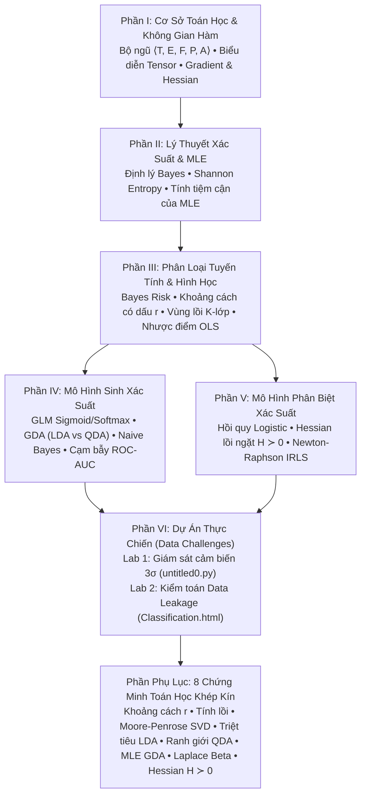
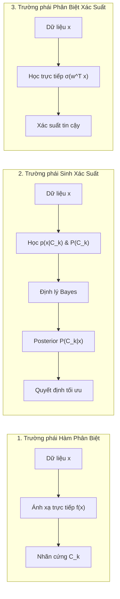
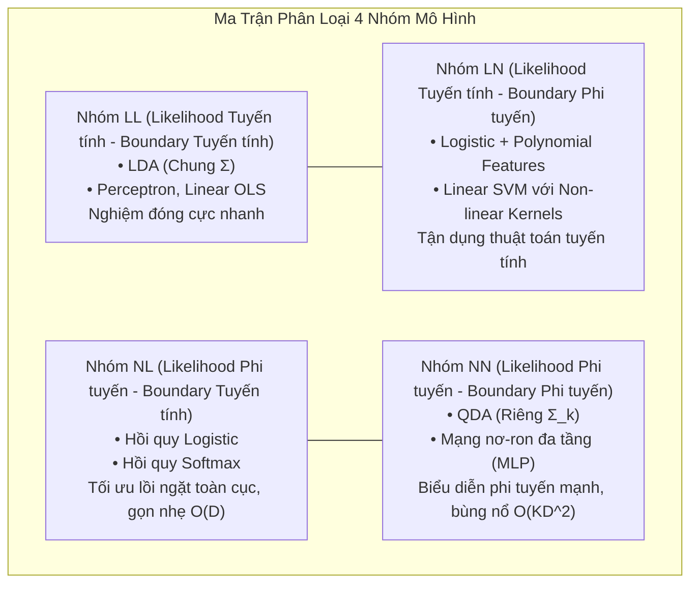
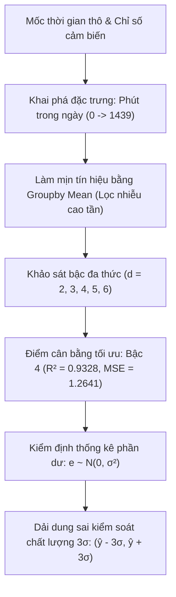

> **BỘ TÀI LIỆU HỌC THUẬT SONG NGỮ (VNUK MIDTERM 2026)**  
> Tài liệu gốc được quy hoạch và chuẩn hóa trực tiếp từ chương trình đào tạo **Machine Learning (Học Máy)** tại **Viện Nghiên Cứu và Đào Tạo Việt – Anh (VNUK), Đại Học Đà Nẵng** (Giảng viên phụ trách: ThS. Nguyễn Chí Thiện & TS. Trần Thanh Hòa). Bạn đọc có thể truy cập trọn bộ các ấn bản xuất bản chính thức dưới đây:
> 
> * **Tài liệu Ôn tập Midterm Tiếng Việt (Bản chuẩn 101 Trang A4, 484 KB):**  
>   [Tải xuống ML_midterm_vi.pdf (PDF 101 Trang A4)](/downloads/ML_midterm_vi.pdf)
> * **Tài liệu Ôn tập Midterm Tiếng Anh (English Midterm Monograph 101 Trang A4, 458 KB):**  
>   [Tải xuống ML_midterm_en.pdf (PDF 101 Trang A4)](/downloads/ML_midterm_en.pdf)
> * **Giáo trình Nền tảng Toán & Mạng Sâu (93 Trang A4, 457 KB):**  
>   [Tải xuống Giao_Trinh_Machine_Learning_Toan_Dien.pdf (PDF 93 Trang A4)](/downloads/Giao_Trinh_Machine_Learning_Toan_Dien.pdf)
> * **Phiên bản Tiếng Anh (English Edition kèm Ngân hàng Trắc nghiệm 17 MCQ):**  
>   [Đọc Comprehensive Machine Learning Midterm Monograph →](/posts/machine-learning-midterm-comprehensive-guide/)

---

## Lời Tựa & Tầm Nhìn Sư Phạm

FOCUS KEY 00: TẦM NHÌN KIẾN TRÚC & BẢN ĐỒ TOÀN KHÓA

Trong bối cảnh kỷ nguyên AI bùng nổ, việc tiếp cận Machine Learning đơn thuần như một kỹ thuật lập trình "hộp đen" — nạp dữ liệu vào thư viện `scikit-learn`, gọi hàm `fit()` rồi đọc độ chính xác `score()` — tạo ra những ảo tưởng nguy hiểm về năng lực mô hình. Khi triển khai vào môi trường sản xuất thực tế (production), các hệ thống này nhanh chóng sụp đổ do <mark class="hl-warn">rò rỉ dữ liệu (data leakage)</mark>, phân phối suy biến (distribution shift) hoặc mất kiểm soát trước các mẫu ngoại lai (outliers).

Bộ giáo trình và tài liệu ôn tập **Machine Learning Midterm (101 trang)** được xây dựng nhằm xác lập lại nền tảng học thuật chuẩn mực, kết nối chặt chẽ giữa:
1. **Bản chất Toán học Trừu tượng**: Xem học máy là quá trình tìm kiếm tự động trong không gian hàm (Function Space), tận dụng đại số ma trận, giải tích đa biến và lý thuyết xác suất Bayes.
2. **Hình học Ranh giới Quyết định**: Giải mã trực giác hình học của các siêu phẳng phân tách, khoảng cách có dấu, tính lồi của các vùng quyết định và sự biến dạng từ ranh giới phẳng sang mặt cong bậc hai.
3. **Động học Tối ưu hóa Khắt khe**: So sánh nghiệm giải tích dạng đóng (OLS Normal Equation, Moore-Penrose Pseudoinverse) với các thuật toán tối ưu hóa lặp bậc hai (Newton-Raphson, IRLS) trên hàm mất mát lồi ngặt.
4. **Kỷ Luật Dữ Liệu Công Nghiệp**: Nhận diện các lỗi rò rỉ dữ liệu tinh vi trong các pipeline tiền xử lý và thiết lập quy trình kiểm định phần dư $3\sigma$ trên chuỗi tín hiệu cảm biến IoT.

Toàn bộ tài liệu bao gồm **6 Phần lớn (17 Chương)** và **8 Phụ lục chứng minh toán học** được kết nối trực quan qua sơ đồ dưới đây:

---

## PHẦN I: CƠ SỞ TOÁN HỌC VÀ KHÔNG GIAN HÀM TRONG MACHINE LEARNING

### 1. Bản Chất Của Học Máy & Bộ Ngũ 5-Tuple $\langle T, E, \mathcal{F}, P, A \rangle$

FOCUS KEY 01: ĐỊNH NGHĨA CHUẨN MỰC BỘ NGŨ 5-TUPLE

Học máy không phải là sự tích lũy dữ liệu thô mà là quá trình <mark class="hl-focus">khái quát hóa (generalization)</mark>. Theo mô hình hóa kinh điển của Tom Mitchell và Michael I. Jordan, một bài toán học máy hoàn chỉnh được định nghĩa chính xác qua <mark class="hl-zoom">bộ ngũ 5 thành phần</mark>:

$$
\mathcal{M} = \langle T, E, \mathcal{F}, P, A \rangle
$$

* **$T$ (Task - Tác vụ nghiệp vụ)**: Bài toán cần giải quyết, ví dụ: Hồi quy ($f: \mathbb{R}^d \to \mathbb{R}$), Phân loại nhị phân ($f: \mathbb{R}^d \to \{0, 1\}$), Phân loại $K$ lớp ($f: \mathbb{R}^d \to \{1, \dots, K\}$), hoặc Giảm chiều dữ liệu.
* **$E$ (Experience - Kinh nghiệm dữ liệu)**: Tập quan sát mẫu $\mathcal{D} = \{(x_i, y_i)\}_{i=1}^N$ (học có giám sát) hoặc $\mathcal{D} = \{x_i\}_{i=1}^N$ (học không giám sát).
* **$\mathcal{F}$ (Function Space - Không gian hàm ứng viên)**: Không gian các hàm số mà thuật toán được phép tìm kiếm, thường được tham số hóa bởi vector $\theta \in \Theta$: $\mathcal{F}_\Theta = \{f(x; \theta) : \theta \in \Theta\}$.
* **$P$ (Performance Measure - Thước đo hiệu năng)**: Tiêu chuẩn định lượng chất lượng của hàm, ví dụ: Hàm mất mát rủi ro thực nghiệm $\hat{R}(f)$, $R^2$, Mean Squared Error (MSE), Cross-Entropy, Accuracy, hoặc Macro-$F_1$.
* **$A$ (Algorithm - Thuật toán tối ưu)**: Cơ chế tìm kiếm nghiệm $\theta^*$ trong không gian tham số, ví dụ: Phương trình chuẩn giải tích (Normal Equation), Hạ độ dốc (Gradient Descent), hoặc Newton-Raphson.

<strong>CẠM BẪY THI CỬ — <mark class="hl-warn">TARGET PRESENCE FALLACY</mark>:</strong> 
Sự hiện diện của một cột nhãn trong bảng dữ liệu không bắt buộc mọi câu hỏi nghiên cứu đều phải quy về Supervised Learning. Ngược lại, việc tự ý gán nhãn cụm (cluster IDs) từ k-Means không hề tạo ra chân lý (ground-truth) được kiểm chứng khoa học.

### 2. Không Gian Vector Trừu Tượng, Hệ Hàm Cơ Sở & Biểu Diễn Tensor

FOCUS KEY 02: ÁNH XẠ CƠ SỞ & CẤU TRÚC TENSOR

Máy tính không thể thao tác trực tiếp trên các hàm số trừu tượng. Để biến bài toán tìm kiếm hàm số thành bài toán tính toán số học, ta sử dụng cấu trúc **Không gian Vector tuyến tính** $\langle V, \mathbb{R}, +, \cdot \rangle$.

Mỗi hàm số $f(x) \in \mathcal{F}$ được biểu diễn như một <mark class="hl-focus">tổ hợp tuyến tính của $M$ hàm cơ sở (Basis Functions)</mark> $\{\phi_j(x)\}_{j=1}^M$:

$$
f(x) = \sum_{j=1}^M w_j \phi_j(x) = \mathbf{w}^T \boldsymbol{\phi}(x)
$$

Bằng cách này, việc tìm kiếm hàm số trong không gian vô hạn chiều được rút gọn thành việc tìm kiếm vector trọng số $\mathbf{w} \in \mathbb{R}^M$ trong không gian Euclid hữu hạn chiều.

Dữ liệu quan sát trong Machine Learning được tổ chức dưới dạng cấu trúc đa chiều (Tensors):
* **Tensor bậc 0 (Scalar)**: Giá trị vô hướng đơn lẻ ($y \in \mathbb{R}$).
* **Tensor bậc 1 (Vector)**: Vector đặc trưng của một mẫu quan sát ($x \in \mathbb{R}^D$).
* **Tensor bậc 2 (Matrix)**: Bảng dữ liệu thiết kế $X \in \mathbb{R}^{N \times D}$ gồm $N$ mẫu và $D$ biến.
* **Tensor bậc 3**: Dữ liệu ảnh màu đơn lẻ $[C, H, W]$ với 3 kênh RGB hoặc chuỗi thời gian nhiều kênh $[N, T, D]$.
* **Tensor bậc 4**: Lô huấn luyện (Batch) ảnh $[B, C, H, W]$ trong mạng nơ-ron học sâu.

### 3. Tối Ưu Hóa Đạo Hàm, Trường Gradient, Jacobian & Ma Trận Hessian

FOCUS KEY 03: ĐIỀU KIỆN CỰC TRỊ VÀ ĐỘ CONG HESSIAN

Thuật toán học máy tìm kiếm nghiệm tối ưu thông qua hình học vi phân của hàm mất mát $\mathcal{L}(\mathbf{w})$:
* **Vector Gradient $\nabla \mathcal{L}(\mathbf{w}) \in \mathbb{R}^D$**: Hướng của vector gradient là hướng hàm số tăng trưởng nhanh nhất; do đó, hướng di chuyển ngược gradient $-\nabla \mathcal{L}(\mathbf{w})$ đảm bảo giảm thiểu hàm mất mát nhanh nhất (Gradient Descent).
* **Ma trận Jacobian $J \in \mathbb{R}^{m \times n}$**: Ma trận đạo hàm riêng cấp một của một ánh xạ vector $\mathbf{f}: \mathbb{R}^n \to \mathbb{R}^m$.
* **Ma trận Hessian $H = \nabla^2 \mathcal{L}(\mathbf{w}) \in \mathbb{R}^{D \times D}$**: Ma trận đạo hàm riêng cấp hai $H_{ij} = \frac{\partial^2 \mathcal{L}}{\partial w_i \partial w_j}$, mô tả độ cong đa chiều của mặt phẳng mất mát (Loss Surface).

<strong>NGUYÊN LÝ VÀNG — ĐIỀU KIỆN CỰC TRỊ CỦA BÀI TOÁN TỐI ƯU:</strong> 
1. <strong>Điều kiện cần cấp một</strong>: <mark class="hl-key">$\nabla \mathcal{L}(\mathbf{w}^*) = \mathbf{0}$</mark> (điểm dừng stationary point). 
2. <strong>Điều kiện đủ cấp hai</strong>: Nếu <mark class="hl-zoom">$H(\mathbf{w}^*) \succ 0$</mark> (Hessian xác định dương ngặt tại mọi điểm), hàm mất mát là <strong>hàm lồi ngặt (strictly convex)</strong>, điểm dừng $\mathbf{w}^*$ là <mark class="hl-focus">cực tiểu toàn cục duy nhất</mark>.

---

## PHẦN II: LÝ THUYẾT XÁC SUẤT VÀ NGUYÊN LÝ HỢP LÝ CỰC ĐẠI (MLE)

### 4. Cơ Sở Xác Suất, Định Lý Bayes & Entropy Thông Tin

FOCUS KEY 04: ĐỊNH LÝ BAYES & ĐỘ BẤT ĐỊNH ENTROPY

Định lý Bayes xác lập cầu nối toán học giữa niềm tin tiên nghiệm (Prior) và nhận thức hậu nghiệm (Posterior) sau khi quan sát dữ liệu:

$$
P(C_k | x) = \frac{p(x | C_k) P(C_k)}{p(x)} = \frac{p(x | C_k) P(C_k)}{\sum_{j=1}^K p(x | C_j) P(C_j)}
$$

* $P(C_k)$: Xác suất Tiên nghiệm (Prior) — tỷ lệ xuất hiện tự nhiên của lớp $C_k$ khi chưa quan sát đặc trưng $x$.
* $p(x | C_k)$: Hàm Khả năng (Likelihood) — mật độ xác suất quan sát thấy vector đặc trưng $x$ nếu mẫu thực sự thuộc lớp $C_k$.
* $p(x) = \sum_j p(x | C_j)P(C_j)$: Thừa số chuẩn hóa biên (Evidence).
* $P(C_k | x)$: Xác suất Hậu nghiệm (Posterior) — độ tin cậy được cập nhật rằng mẫu thuộc về lớp $C_k$ sau khi đã đo đạc $x$.

**Độ hỗn loạn thông tin (<mark class="hl-key">Shannon Entropy</mark>):**
Thước đo độ bất định tiềm tàng của một biến ngẫu nhiên rời rạc $X$:

$$
H(X) = -\sum_{i=1}^n P(x_i) \log_2 P(x_i)
$$

### 5. Nguyên Lý MLE & Thực Nghiệm Mô Phỏng Monte Carlo

FOCUS KEY 05: ƯỚC LƯỢNG MLE & 3 TÍNH CHẤT TIỆM CẬN

Nguyên lý **Ước lượng Hợp lý Cực đại (Maximum Likelihood Estimation - MLE)** chọn tham số $\hat{\theta}_{\text{MLE}}$ làm cực đại hóa xác suất sinh ra đúng tập quan sát $\mathcal{D}$:

$$
\ell(\theta) = \sum_{n=1}^N \ln p(x_n; \theta) \implies \hat{\theta}_{\text{MLE}} = \arg\max_\theta \ell(\theta)
$$

#### Nghiệm Giải Tích Cho Phân Phối Chuẩn Đa Biến $\mathcal{N}(\mu, \Sigma)$
$$
\hat{\mu}_{\text{MLE}} = \frac{1}{N} \sum_{n=1}^N x_n, \qquad \hat{\Sigma}_{\text{MLE}} = \frac{1}{N} \sum_{n=1}^N (x_n - \hat{\mu})(x_n - \hat{\mu})^T
$$

<strong>TRỰC GIÁC THỐNG KÊ — HIỆU CHỈNH BESSEL:</strong> 
Ước lượng phương sai $\hat{\Sigma}_{\text{MLE}}$ bị <mark class="hl-warn">thiên lệch nhẹ (biased)</mark> do chia cho $N$. Trong thống kê không thiên lệch, mẫu số được hiệu chỉnh thành $N - 1$. Tuy nhiên, khi $N \to \infty$, độ lệch này tiệm cận hoàn toàn về 0. MLE bảo đảm 3 tính chất tiệm cận vàng: <mark class="hl-focus">Tính nhất quán (Consistency)</mark>, <mark class="hl-focus">Tính chuẩn tiệm cận (Asymptotic Normality)</mark>, và <mark class="hl-focus">Hiệu quả tiệm cận (Asymptotic Efficiency)</mark> đạt chặn dưới Cramér-Rao.

---

## PHẦN III: MÔ HÌNH PHÂN LOẠI TUYẾN TÍNH VÀ HÌNH HỌC QUYẾT ĐỊNH

### 6. Bản Chất Phân Loại, Tách Biệt Inference vs Decision & Bayes Risk

FOCUS KEY 06: QUY TẮC TỐI THIỂU HÓA RỦI RO BAYES

Giáo trình nhấn mạnh sự phân tách rạch ròi giữa hai giai đoạn độc lập:
* **<mark class="hl-key">Giai đoạn Suy diễn (Inference Phase)</mark>**: Ước lượng phân phối xác suất hậu nghiệm $P(C_k | x)$.
* **<mark class="hl-key">Giai đoạn Quyết định (Decision Phase)</mark>**: Áp dụng ma trận tổn thất $L_{kj}$ để đưa ra hành động tối ưu hóa rủi ro kỳ vọng:

$$
\hat{k} = \arg\min_j \mathcal{R}(j | x) = \arg\min_j \sum_{k=1}^K L_{kj} P(C_k | x)
$$

### 7. Hình Học Linear Discriminant & Khoảng Cách Có Dấu $r = \frac{g(x)}{\|w\|_2}$

FOCUS KEY 07: HÌNH HỌC VECTOR PHÁP TUYẾN & KHOẢNG CÁCH CÓ DẤU

Hàm phân biệt tuyến tính cơ bản: $g(x) = \mathbf{w}^T x + w_0$.

#### 1. Vector Trọng Số $\mathbf{w}$ Trực Giao Với Siêu Phẳng Ranh Giới
Chọn hai điểm bất kỳ $x_A, x_B \in \mathcal{P} = \{x : g(x) = 0\}$, trừ hai phương trình:

$$
\mathbf{w}^T (x_A - x_B) = 0 \iff \mathbf{w} \perp (x_A - x_B)
$$

Vector $\mathbf{w}$ chính là <mark class="hl-focus">vector pháp tuyến vuông góc với siêu phẳng ranh giới</mark>, chỉ về phía nửa không gian dương ($g(x) > 0$).

#### 2. Công Thức Khoảng Cách Đại Số Có Dấu (Signed Distance)
Phân rã điểm $x$ thành hình chiếu $x_p \in \mathcal{P}$ và thành phần trực giao $r \frac{\mathbf{w}}{\|\mathbf{w}\|_2}$:

$$
g(x) = \mathbf{w}^T \left( x_p + r \frac{\mathbf{w}}{\|\mathbf{w}\|_2} \right) + w_0 = \underbrace{\mathbf{w}^T x_p + w_0}_{= 0} + r \|\mathbf{w}\|_2 \implies r = \frac{g(x)}{\|\mathbf{w}\|_2} = \frac{\mathbf{w}^T x + w_0}{\|\mathbf{w}\|_2}
$$

Khoảng cách từ gốc tọa độ $O$ tới siêu phẳng: <mark class="hl-key">$r_O = \frac{w_0}{\|\mathbf{w}\|_2}$</mark>.

### 8. Phân Loại Đa Lớp, Tính Lồi Vùng Quyết Định & Hồi Quy Least Squares

FOCUS KEY 08: CHỨNG MINH TÍNH LỒI VÙNG QUYẾT ĐỊNH & THẤT BẠI CỦA OLS

#### Hệ $K$ Hàm Phân Biệt & Chứng Minh Tính Lồi Vùng Quyết Định
Để loại bỏ các vùng mơ hồ (OvR) và bế tắc hòa phiếu (OvO), hệ thống phân loại chuẩn dùng $K$ hàm: $g_k(x) = \mathbf{w}_k^T x + w_{k0}$.

<strong>CHỨNG MINH HỌC THUẬT — MỌI MIỀN QUYẾT ĐỊNH $\mathcal{R}_k$ ĐỀU LÀ TẬP LỒI:</strong> 
Chọn hai điểm bất kỳ $x_A, x_B \in \mathcal{R}_k$. Điểm $x = \alpha x_A + (1 - \alpha) x_B$ nằm trên đoạn thẳng nối hai điểm. Do tính tuyến tính: 
$$
g_k(x) = \alpha g_k(x_A) + (1 - \alpha) g_k(x_B) > \alpha g_j(x_A) + (1 - \alpha) g_j(x_B) = g_j(x), \quad \forall j \ne k
$$
Điều này chứng minh $x \in \mathcal{R}_k$. <strong>Kết luận:</strong> Các vùng quyết định của hệ $K$ hàm phân biệt tuyến tính luôn là <strong>các tập lồi liên thông (convex polytopes)</strong>, hoàn toàn không bao giờ bị đứt gãy hoặc chứa lỗ hổng.

#### Phân Loại Bằng Least Squares (OLS) & 3 Nhược Điểm Cốt Tử
Nghiệm giải tích dạng đóng: $W^* = (\tilde{X}^T \tilde{X})^{-1} \tilde{X}^T T = \tilde{X}^\dagger T$ (với $\tilde{X}^\dagger$ là giả nghịch đảo Moore-Penrose).  
Least Squares bị khai tử trong phân loại vì:
1. <mark class="hl-warn">Cực kỳ nhạy cảm với ngoại lai (Outliers)</mark>: Bình phương sai số $(y_n - 1)^2$ phạt nặng các mẫu dự đoán "quá đúng" ($y_n \gg 1$), làm lệch hoàn toàn siêu phẳng.
2. **Đầu ra phi xác suất**: Giá trị dự đoán có thể âm hoặc vượt quá 1.
3. <mark class="hl-warn">Hiện tượng che lấp lớp (Masking Effect khi $K \ge 3$)</mark>: Lớp nằm ở giữa bị ép phẳng, khiến mô hình không bao giờ dự đoán vào lớp giữa.

---

## PHẦN IV: CÁC MÔ HÌNH SINH XÁC SUẤT (PROBABILISTIC GENERATIVE MODELS)

### 9. GLM, Hàm Sigmoid, Softmax & Chứng Minh Từ Bayes

FOCUS KEY 09: LOG-ODDS LOGIT & HÀM SOFTMAX

Áp dụng định lý Bayes, xác suất hậu nghiệm nhị phân:

$$
P(C_1 | x) = \frac{1}{1 + \exp(-a)} = \sigma(a), \quad a = \ln \frac{P(C_1 | x)}{P(C_2 | x)} = \ln \frac{p(x | C_1)}{p(x | C_2)} + \ln \frac{P(C_1)}{P(C_2)}
$$

Khi mở rộng $K$ lớp: $P(C_k | x) = \operatorname{Softmax}(a)_k = \frac{\exp(a_k)}{\sum_j \exp(a_j)}$. Hàm Sigmoid và Softmax là <mark class="hl-zoom">hệ quả toán học tất yếu từ Định lý Bayes</mark>.

### 10. Gaussian Discriminant Analysis (GDA): LDA vs QDA

FOCUS KEY 10: TRIỆT TIÊU BẬC HAI LDA VS BÙNG NỔ THAM SỐ QDA

#### 1. LDA (Linear Discriminant Analysis) — Dùng Chung Ma Trận $\Sigma$
Khi $\Sigma_1 = \Sigma_2 = \Sigma$, trong khai triển tỷ số Log-Odds:

$$
a(x) = -\frac{1}{2} (x - \mu_1)^T \Sigma^{-1} (x - \mu_1) + \frac{1}{2} (x - \mu_2)^T \Sigma^{-1} (x - \mu_2) + \ln \frac{\pi_1}{\pi_2}
$$

Số hạng bậc hai $x^T \Sigma^{-1} x$ <mark class="hl-focus">triệt tiêu lẫn nhau hoàn toàn</mark>:

$$
a(x) = (\mu_1 - \mu_2)^T \Sigma^{-1} x - \frac{1}{2} \mu_1^T \Sigma^{-1} \mu_1 + \frac{1}{2} \mu_2^T \Sigma^{-1} \mu_2 + \ln \frac{\pi_1}{\pi_2} = \mathbf{w}^T x + w_0
$$

Ranh giới quyết định $a(x) = 0$ là một **siêu phẳng tuyến tính phẳng**.

#### 2. QDA (Quadratic Discriminant Analysis) — Ma Trận $\Sigma_k$ Riêng Biệt
Khi $\Sigma_1 \ne \Sigma_2$, số hạng $-\frac{1}{2} x^T (\Sigma_1^{-1} - \Sigma_2^{-1}) x \ne 0$ tạo nên các **<mark class="hl-key">mặt cong bậc hai Quadric Surfaces</mark>** (Elip, Parabol, Hyperbol).

| Tiêu chí | LDA (Shared Covariance) | QDA (Class-Specific Covariance) |
|---|---|---|
| Số ma trận $\Sigma$ | 1 ma trận chung | $K$ ma trận riêng biệt |
| Độ phức tạp tham số | $\mathcal{O}(KD + D^2)$ | $\mathcal{O}(K \cdot D^2)$ (Bùng nổ tổ hợp) |
| **Ví dụ: $D=50, K=10$** | **$1,784$ tham số** | **$13,259$ tham số** (Gấp 7.4 lần) |

### 11. Naive Bayes, Lời Nguyền Số Chiều & Làm Mịn Laplace

FOCUS KEY 11: ĐỘC LẬP CÓ ĐIỀU KIỆN & LÀM MỊN LAPLACE

Naive Bayes giả định mọi đặc trưng độc lập có điều kiện khi biết nhãn lớp: $p(x | C_k) = \prod_{j=1}^D p(x_j | C_k)$, đưa ma trận hiệp phương sai về dạng đường chéo $\mathcal{O}(KD)$.

<strong>CẠM BẪY SỤP ĐỔ XÁC SUẤT BẰNG 0:</strong> 
Nếu một từ vựng $x_j$ chưa từng xuất hiện trong lớp $k$ ở tập huấn luyện, tần suất $\hat{p}(x_j | C_k) = 0$. Do phép nhân chuỗi, <mark class="hl-warn">chỉ một thừa số 0 sẽ kéo sụp toàn bộ tích số xác suất về 0 tuyệt đối</mark>. Kỹ thuật <mark class="hl-focus">Làm mịn Laplace (Laplace Smoothing)</mark> bổ sung giả lượng quan sát $\alpha \ge 1$ (tiên nghiệm Beta/Dirichlet MAP): 
$$
\hat{p}(x_j = 1 | C_k) = \frac{N_{jk} + \alpha}{N_k + 2\alpha}
$$

### 12. Đánh Giá Mô Hình: Accuracy Fallacy & Cạm Bẫy ROC-AUC

FOCUS KEY 12: ĐÁNH GIÁ MÔ HÌNH VÀ CẠM BẪY ROC-AUC

$$
\text{Precision} = \frac{TP}{TP + FP}, \qquad \text{Recall} = \frac{TP}{TP + FN}, \qquad F_1 = \frac{2 \cdot \text{Precision} \cdot \text{Recall}}{\text{Precision} + \text{Recall}}
$$

<strong>CẠM BẪY ROC-AUC KHI MẤT CÂN BẰNG DỮ LIỆU CỰC ĐOAN:</strong> 
Khi tỷ lệ dương tính cực thấp (ví dụ: $0.1\%$ gian lận), số lượng báo động nhầm $FP$ dù tăng vọt vẫn bị mẫu số khổng lồ $(TN + FP)$ đè bẹp, khiến $FPR \approx 0$. Đường cong ROC hiển thị <mark class="hl-warn">giá trị ảo rất cao ($> 0.95$)</mark>. Trong trường hợp này, <mark class="hl-focus">PR-AUC (Precision-Recall AUC)</mark> là thước đo bắt buộc duy nhất phản ánh trung thực năng lực phân loại.

---

## PHẦN V: CÁC MÔ HÌNH PHÂN BIỆT XÁC SUẤT VÀ HỒI QUY LOGISTIC

### 13. Hồi Quy Logistic: Mô Hình Hóa Phân Biệt & Gradient Cross-Entropy

FOCUS KEY 13: LOGISTIC REGRESSION & GRADIENT MA TRẬN

Mô hình hóa trực tiếp Posterior: $P(C_1 | x) = y(x) = \sigma(\mathbf{w}^T x) = \frac{1}{1 + e^{-\mathbf{w}^T x}}$.  
Hàm mất mát Negative Log-Likelihood (Cross-Entropy):

$$
E(\mathbf{w}) = -\sum_{n=1}^N \Big[ t_n \ln y_n + (1 - t_n) \ln(1 - y_n) \Big]
$$

Gradient ma trận toàn phần (<mark class="hl-focus">các số hạng phi tuyến triệt tiêu nhau hoàn hảo</mark>):

$$
\nabla E(\mathbf{w}) = \sum_{n=1}^N (y_n - t_n) x_n = X^T (\mathbf{y} - \mathbf{t})
$$

### 14. Tính Lồi Ngặt Của Hessian & Thuật Toán Tối Ưu IRLS

FOCUS KEY 14: CHỨNG MINH H ≻ 0 & THUẬT TOÁN IRLS

Ma trận Hessian $H \in \mathbb{R}^{(D+1) \times (D+1)}$:

$$
H = \nabla^2 E(\mathbf{w}) = \sum_{n=1}^N y_n (1 - y_n) x_n x_n^T = X^T R X
$$

trong đó $R = \operatorname{diag}(y_1(1-y_1), \dots, y_N(1-y_N))$ với $R_{nn} > 0$.

<strong>CHỨNG MINH MA TRẬN HESSIAN XÁC ĐỊNH DƯƠNG NGẶT ($H \succ 0$):</strong> 
Với mọi vector $\mathbf{u} \ne \mathbf{0}$: 
$$
\mathbf{u}^T H \mathbf{u} = \mathbf{u}^T (X^T R X) \mathbf{u} = (X \mathbf{u})^T R (X \mathbf{u}) = \sum_{n=1}^N R_{nn} (x_n^T \mathbf{u})^2 > 0
$$
Vì $R_{nn} > 0$ và các cột của $X$ độc lập tuyến tính. <strong>Ý nghĩa:</strong> Hàm Cross-Entropy là <mark class="hl-zoom">hàm lồi ngặt (strictly convex) toàn cục</mark>, không có bất kỳ điểm cực tiểu địa phương nào.

#### Biến Đổi Newton-Raphson Thành Thuật Toán IRLS
Quy tắc cập nhật bậc hai $\mathbf{w}^{(\text{new})} = \mathbf{w}^{(\text{old})} - H^{-1} \nabla E$ biến đổi thành:

$$
\mathbf{w}^{(\text{new})} = (X^T R X)^{-1} X^T R \mathbf{z}, \quad z_n = \mathbf{w}^T x_n - \frac{y_n - t_n}{y_n(1 - y_n)}
$$

Đây chính là nghiệm giải tích của bài toán **<mark class="hl-key">Bình phương Tối thiểu có Trọng số lặp (Iterative Reweighted Least Squares - IRLS)</mark>**.

### 15. So Sánh 3 Trường Phái & Bảng Phân Loại Mô Hình (LL, NL, NN, LN)

FOCUS KEY 15: MA TRẬN PHÂN LOẠI 4 NHÓM MÔ HÌNH

---

## PHẦN VI: THỰC HÀNH MÃ NGUỒN VÀ DỰ ÁN THỰC CHIẾN (DATA CHALLENGES)

### 16. Lab 1: Hồi Quy Đa Thức Chuỗi Cảm Biến & Dải Dung Sai $3\sigma$ (`untitled0.py`)

FOCUS KEY 16: HỒI QUY ĐA THỨC VÀ KIỂM SOÁT DỊ THƯỜNG 3-SIGMA

* **Khảo sát bậc đa thức:** $d=4$ đạt trạng thái tối ưu ($R^2 = 0.9328$, MSE $= 1.2641$). Các bậc $d=5, 6$ bắt đầu xuất hiện dao động Runge ở mốc biên nửa đêm.
* **<mark class="hl-zoom">Quy tắc kiểm soát $3\sigma$</mark>:** Với phần dư đối xứng $e \sim \mathcal{N}(0, \sigma^2)$, xác suất rơi vào dải $[\hat{y} - 3\sigma, \hat{y} + 3\sigma]$ đạt <mark class="hl-zoom">$99.73\%$</mark>. <mark class="hl-warn">Bất kỳ điểm nào vượt ngoài dải đều kích hoạt cảnh báo sự cố phần cứng hoặc cháy nổ trạm đo.</mark>

### 17. Lab 2: Pipeline Phân Loại Adult Census & Kiểm Toán Data Leakage (`Classification.html`)

FOCUS KEY 17: KIỂM TOÁN LỖ HỔNG DATA LEAKAGE

<strong>BÓC TRẦN 2 LỖ HỔNG RÒ RỈ DỮ LIỆU CHẾT NGƯỜI:</strong> 
1. <mark class="hl-warn">Scaler Leakage</mark>: Áp dụng <code>StandardScaler.fit_transform(X)</code> trên toàn bộ tập dữ liệu trước khi chia Train/Test, làm rò rỉ $\mu, \sigma$ của tập Test vào tập Train. 
2. <mark class="hl-warn">Duplication Oversampling Leakage (Nghiêm trọng nhất)</mark>: <code>RandomOverSampler</code> được gọi trên toàn bộ tập dữ liệu trước khi chia Train/Test. Do nhân bản nguyên văn các dòng lớp thiểu số, <strong>hàng nghìn mẫu giống hệt nhau đã nằm đồng thời ở cả Train và Test</strong>. Cây quyết định chỉ việc học thuộc lòng, tạo ra điểm số ảo $>92\%$.

---

## PHẦN PHỤ LỤC: 8 CHỨNG MINH TOÁN HỌC KHÉP KÍN

<strong>TÓM LƯỢC 8 PHỤ LỤC CHỨNG MINH ĐẠI SỐ MA TRẬN TRONG ML_MIDTERM.PDF:</strong> 
* <strong>Phụ lục A</strong>: Chứng minh hình học khoảng cách có dấu $r = \frac{g(x)}{\|\mathbf{w}\|_2}$ qua hình chiếu trực giao $x = x_p + r \frac{\mathbf{w}}{\|\mathbf{w}\|_2}$. 
* <strong>Phụ lục B</strong>: Chứng minh tính lồi của các miền quyết định $\mathcal{R}_k$ qua tổ hợp lồi $g_k(\alpha x_A + (1-\alpha)x_B) > g_j(\alpha x_A + (1-\alpha)x_B)$. 
* <strong>Phụ lục C</strong>: Suy dẫn phương trình chuẩn $\tilde{X}^T \tilde{X} W = \tilde{X}^T T$ và giả nghịch đảo Moore-Penrose $W^* = \tilde{X}^\dagger T$ bằng vi phân ma trận hàm vết Frobenius và SVD. 
* <strong>Phụ lục D</strong>: Chứng minh triệt tiêu số hạng bậc hai $\mathbf{x}^T \boldsymbol{\Sigma}^{-1} \mathbf{x}$ trong LDA khi chia sẻ chung ma trận hiệp phương sai. 
* <strong>Phụ lục E</strong>: Suy dẫn dạng mặt bậc hai tổng quát Quadric Surfaces (elip, hyperbol) trong QDA khi $\Sigma_1 \ne \Sigma_2$. 
* <strong>Phụ lục F</strong>: Suy dẫn giải tích đạo hàm MLE ma trận cho các tham số GDA ($\hat{\pi}_k, \hat{\mu}_k, \hat{\Sigma}_{\text{LDA}}, \hat{\Sigma}_{k, \text{QDA}}$). 
* <strong>Phụ lục G</strong>: Suy dẫn MLE phân phối Bernoulli và làm mịn Laplace qua kỳ vọng hậu nghiệm Beta $\text{Beta}(\alpha + N_1, \beta + N_0)$. 
* <strong>Phụ lục H</strong>: Chứng minh ma trận Hessian $H = X^T R X \succ 0$ xác định dương ngặt tại mọi điểm và suy dẫn thuật toán IRLS từ Newton-Raphson.

---

## Tải Về Toàn Văn Tài Liệu

Toàn bộ các ấn bản chuyên khảo học thuật chuẩn hóa (biên dịch và định dạng chuẩn XeLaTeX) đã sẵn sàng để tải về:

* **Tài liệu Ôn tập Midterm Tiếng Việt**: [ML_midterm_vi.pdf (101 Trang A4, 484 KB)](/downloads/ML_midterm_vi.pdf)
* **Tài liệu Ôn tập Midterm Tiếng Anh (English Edition)**: [ML_midterm_en.pdf (101 Trang A4, 458 KB)](/downloads/ML_midterm_en.pdf)
* **Giáo trình Nền tảng Toán & Mạng Sâu**: [Giao_Trinh_Machine_Learning_Toan_Dien.pdf (93 Trang A4, 457 KB)](/downloads/Giao_Trinh_Machine_Learning_Toan_Dien.pdf)
* **Bản Trực Tuyến Tiếng Anh kèm Ngân hàng 17+ Câu Hỏi Trắc Nghiệm Chuyên Sâu**: [Xem English Edition →](/posts/machine-learning-midterm-comprehensive-guide/)
